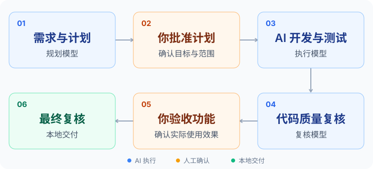
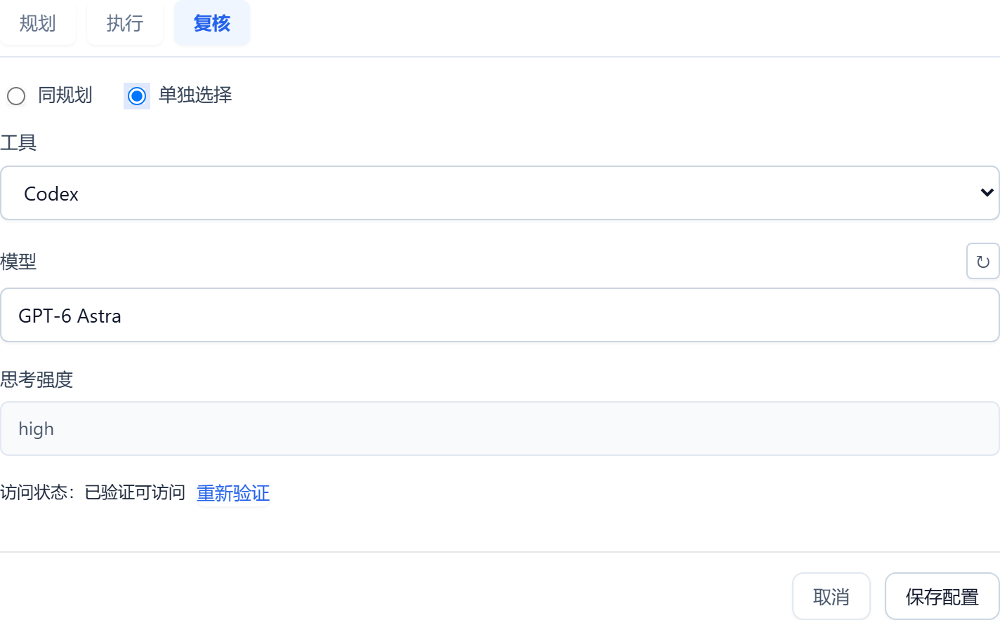
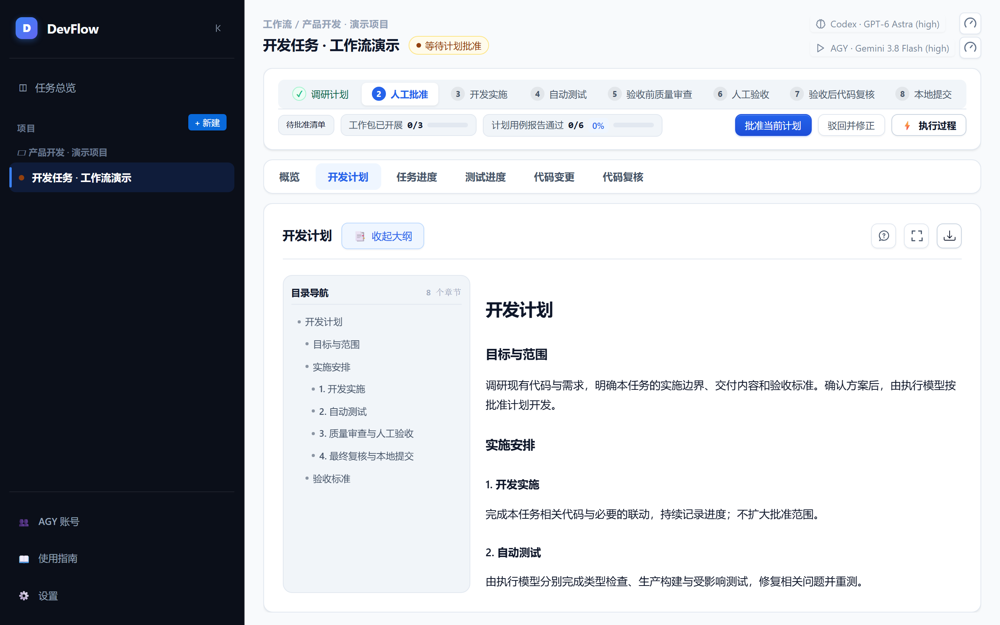
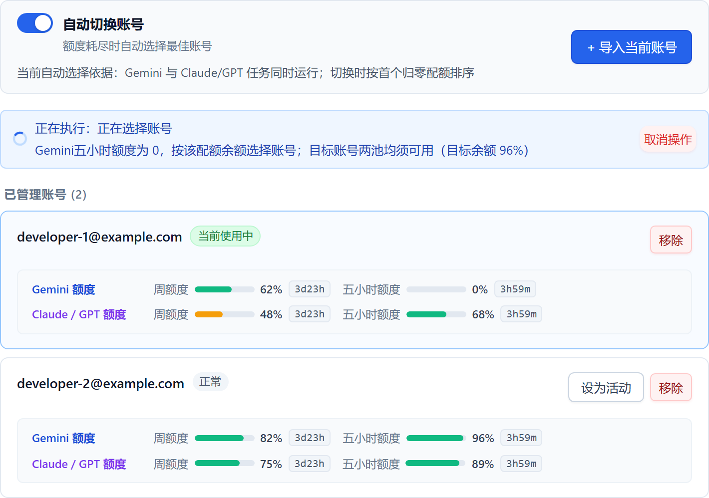

# DevFlow

**轻量化模型调度工作流：模型分工执行，你来审批与验收。**

在本地把调研计划、开发、测试、代码复核和提交串成同一任务。你为各角色选择工具与模型，DevFlow 负责阶段衔接、进度展示和任务续接。

[开始使用](#开始使用) · [自定义模型](#工具与模型由你搭配) · [Agy 自动切换与双额度](#agy-账号与双额度管理) · [使用指南](docs/guide/使用指南.md) · [Releases](https://github.com/zephyrw/dev-flow/releases)

## 模型接力，关键节点由你确认

<picture>
  <source media="(max-width: 600px)" srcset="docs/guide/assets/devflow-workflow-mobile.svg">
  
</picture>

开发与测试由执行模型完成，代码质量由复核模型判断，实际功能由你验收。DevFlow 负责调度与展示；代码或功能问题在原任务中处理，推送与发布另行授权。完整分工见 [职责与调度](packages/skills/devflow/references/role-and-schedule.md)。

## 工具与模型，由你搭配

**工具与模型均可按角色自定义。** 下面是一种搭配示例：

| 角色 | 示例配置 | 负责什么 |
| --- | --- | --- |
| 规划模型 | Codex · GPT-6 Astra | 调研计划、本地提交 |
| 执行模型 | Agy · Gemini 3.8 Flash | 开发实施、自动测试及相关修复 |
| 复核模型 | Codex · GPT-6 Astra | 验收前质量审查、验收后代码复核 |

复核可跟随规划，也可单独指定工具、模型与思考强度。全局默认用于新任务，已有任务可以单独调整；可用模型取决于所接入客户端和账号授权。



## 过程可见，任务可以接着做

在同一工作台查看计划、任务进度、测试结果与代码差异。你可以批准计划、发送指导、暂停任务、反馈验收问题；需要继续时回到原任务，保留已有进度与上下文。



## Agy 账号与双额度管理

为 Agy（Antigravity CLI）集中管理登录账号，并与工作流衔接：

- **多账号管理**：导入账号，查看身份、可用状态和当前使用账号，也可手动指定切换。
- **双额度查看**：同时显示**周额度与 5 小时额度**的剩余量和恢复时间，分别查看 Gemini、Claude/GPT 额度池。
- **额度耗尽自动切换**：开启后，确认额度耗尽时选择可用账号，再续接受影响的原任务。候选须满足模型权限和双额度条件；没有可用账号时保留进度等待。



界面截图来自当前源码，任务、账号和额度均为虚构演示数据。账号接入条件及切换规则见 [使用指南](docs/guide/使用指南.md#agy-账号与额度管理)。

## 开始使用

### 一行安装

支持 **Windows x64、macOS Intel / Apple Silicon、Linux x64**。安装包内置 Node.js 和运行依赖，无需先搭建 DevFlow 开发环境。

**macOS（Intel / Apple Silicon）与 Linux x64**

```bash
bash -o pipefail -c 'curl -fsSL https://github.com/zephyrw/dev-flow/releases/latest/download/install.sh | bash'
```

**Windows x64 · PowerShell**

```powershell
& ([scriptblock]::Create([Text.Encoding]::UTF8.GetString((iwr -UseBasicParsing -ErrorAction Stop https://github.com/zephyrw/dev-flow/releases/latest/download/install.ps1).RawContentStream.ToArray()).TrimStart([char]0xFEFF)))
```

安装完成后，用 `devflow` 打开工作台，按提示接入编程助手、完成授权并选择模型。固定版本、离线安装与更新方法见 [安装与升级](docs/guide/安装与升级.md)。

### 从源码运行

获取源码后，准备 **Node.js ≥ 22.23.2** 和 **pnpm 11.7.0**，在仓库目录执行：

```bash
pnpm install --frozen-lockfile
pnpm build
pnpm start
```

服务启动后打开 [本地工作台](http://localhost:4810)。客户端与 Skill 配置、开发及检查入口见 [开发指南](docs/development/开发指南.md)。

### 第一个任务

安装并配置 DevFlow 后，以 Codex 为例：打开你的业务项目，新建任务并输入：

> 用 DevFlow 帮我修复客户列表筛选的问题：选择负责人后，列表没有变化。先给我计划，确认后再修改。

随后在工作台批准计划、查看执行过程并验收功能。

## 客户端与平台

已实现 **Codex、Antigravity CLI、Claude Code、Cursor Agent、Kimi Code、MiMo Code、Grok Build、Qoder、OpenCode** 的客户端适配。

安装包构建目标为 **Windows x64、macOS Intel / Apple Silicon、Linux x64**。各平台与客户端的实测范围见 [客户端兼容性](docs/guide/客户端兼容性.md)；macOS Apple Silicon 的完整包安装与 AGY 任务记录见 [验收记录](docs/test/macos-install-20261008/验收记录.md)。

## 使用须知

- 模型账号、订阅和额度由所选客户端或服务商提供。
- DevFlow 在本机运行；调用云端模型时，客户端会发送任务所需内容。
- 关闭网页不会停止任务。暂停、反馈与恢复在工作台操作。

## 文档与贡献

| 文档 | 内容 |
| --- | --- |
| [使用指南](docs/guide/使用指南.md) | 首个任务、计划审批、反馈与验收 |
| [安装与升级](docs/guide/安装与升级.md) | 安装、更新、诊断与卸载 |
| [使用与恢复](docs/guide/使用与恢复指南.md) | 日常操作与任务中断恢复 |
| [客户端兼容性](docs/guide/客户端兼容性.md) | 工具、平台及验证范围 |
| [开发指南](docs/development/开发指南.md) · [贡献指南](CONTRIBUTING.md) | 工具链、构建、测试与贡献流程 |

## 许可证

[Apache License 2.0](LICENSE)
