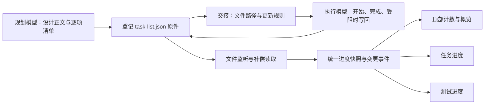

# 任务清单 JSON 与开发、测试实时进度改造计划

日期：2026-11-10。当前阶段：完成代码调查与修改规划，尚未实施。

## 1. 背景、现状与目标

DevFlow 将规划模型批准后的任务交给执行模型开发和测试。用户需要在执行期间看到每项工作的真实进展，以判断当前在做什么、已经完成多少、哪些测试失败或受阻。

用户提供的页面中，执行过程持续出现命令和文件操作，但开发计数仍为 `0/80`，概览中的多项任务同时显示“进行中”，测试长期显示待执行或未回传。用户要求规划阶段提供详细任务清单 JSON，执行模型每完成一项就更新文件，变化实时显示在概览、任务进度和测试进度中。

本次调查确认当前源码存在以下缺口；尚未读取截图任务的运行数据库，因此这些结论说明代码机制，不声称已核实该任务的全部运行历史。

| 已确认的代码行为 | 对进度展示的影响 |
| --- | --- |
| `NativeWorkItemSchema` 包含任务、依赖和验收编号，没有逐项运行状态 | 计划能表达要做什么，不能直接承载每项当前进度 |
| `Engine.taskStatus()` 的轻量协议分支根据整轮完成记录，为所有任务统一生成 `in_progress` 或 `completed` | 开始执行后全部任务看起来都在进行，整轮结束后又一起完成 |
| 开展数量统计接受 `active/completed/pending_check`，与上述 `in_progress` 不一致；前端还根据文件变化重新投影 | 任务行与顶部计数可能互相矛盾；文件定位为空或操作未识别时更明显 |
| `recordExecutionTestReport()` 主要由 `receiveRoundResult()` 接收最终或求助回执时调用 | 有部分结果保存能力，但缺少同一回合持续执行期间的结果入口 |
| 现有 WebSocket 会推送领域事件；`useNativeProgress()` 主要观察历史命令和每 15 秒读取文件差异 | 可以复用推送通道，但不能从命令或文件变化可靠得知计划项完成情况 |
| 概览测试状态只有待执行、通过、失败、待复测，部分旧测试名称回退为“测试项 N” | 无法完整表达运行中、受阻、跳过，也不便于识别具体场景 |

目标是：**规划模型生成逐项可执行的清单；执行模型随工作推进更新同一 JSON；后端持续接收；四处展示——顶部计数、概览、任务进度、测试进度——使用同一份状态。** 在模型回合尚未结束、工作流仍处于执行中时，也能看到任务和测试逐项变化。

这样安排是因为仅加强最终总结或提高页面刷新频率，都不能补出尚未记录的逐项状态。必须同时解决清单生成、更新责任、文件同步和展示口径。

## 2. 总体方案与边界

沿用正式开发计划正文，新增其配套的 `task-list.json`。规划模型负责清单内容，平台负责登记唯一文件位置、初始化并交接。执行模型持续维护状态；平台将合法文件内容保存为展示快照，再通过现有 WebSocket 通知页面。



关键约定：

- 正式 Markdown 解释背景、设计和批准范围；JSON 保存同一批任务、测试编号和逐项状态。JSON 是配套清单，不是执行模型另建的替代计划。
- 启用新清单后，逐项开发和测试状态以该文件为源，数据库只保存可恢复的展示快照。页面不再根据日志、代码文件数量或整轮完成状态推断清单状态。
- JSON 的状态变化不修改工作流业务版本、不触发重新审批、不改变质量复核和人工验收流程。
- 平台只检查 JSON 格式、字段、任务归属及更新冲突，不审计实现或测试真实性，不新增证明文件、代码哈希核验或测试门禁。
- **任务和测试的执行顺序、并行方式及测试时机由执行模型根据实际情况自主决定。** 清单编号、排列和状态更新规则不构成调度约束；真实技术依赖仍须满足，可以同时有多个任务进行中、多个测试运行中。
- **提示词只要求在每项状态变化时及时更新 JSON。** 更新不等待其他任务、某个批次或整个模型回合结束，也不要求全部开发完成后才能开始测试。对已有交接和技能中的冲突表述同步修订；保留必要检查、最终结果适用性、角色和权限边界。
- 本轮范围覆盖规划提交、执行与测试交接、文件同步、持久化、页面展示、恢复与历史兼容。当前交付是计划；源码修改、运行中任务接入和发布由后续实施完成。

## 3. 清单文件与数据规则

### 3.1 唯一位置与生成方式

新任务默认位置：`<已登记项目文档根>/docs/plan/<workflow_id>/task-list.json`。

复用项目材料定位能力，由平台登记绝对路径和所属工作流。多仓库任务只有一份总清单，每项用 `repo_id` 标明仓库。执行工作树创建、模型切换、恢复执行时均使用登记路径，不在各仓库或各 Run 中复制另一份。

规划模型继续提供 `work_items`、`acceptance_items` 等结构化内容，补齐任务说明和可观察的完成标准。平台在正式提交计划时，以这份内容生成 JSON，并登记 `task_list_ref`；现有计划索引由同一份内容转换，避免规划模型分别维护两套不一致的编号。

两条入口必须一致：平台内规划模型的计划返回，以及外部客户端的 `devflow_submit_plan`。已有指定计划保留正文和原编号，只补配套清单。规划初始化只写入缺失文件；恢复或再次交接不能覆盖既有状态。

### 3.2 清单应详细到什么程度

每项任务应是可以独立说明“完成了什么”的工作单元，例如“贯通文件监听到页面刷新”，而不是只写“修改后端”。任务字段包括编号、模块、标题、工作说明、正文位置、真实依赖、完成标准和关联测试。`depends_on` 只记录确有的技术依赖，不按任务编号机械串联，也不作为平台调度门禁。文件路径只作定位提示，不成为修改白名单。

测试按计划场景记录稳定的 `test_id + case_id`，写明层次、操作场景和预期结果。不能用“测试项 1”替代场景名称，也不能用测试文件路径替代计划编号。具体命令在执行时补充，规划阶段不强行预定尚未实现的测试名称。

| 数据部分 | 主要字段 | 责任 |
| --- | --- | --- |
| 文件身份 | `schema_version`、`workflow_id`、`plan_ref` | 平台登记与兼容读取 |
| 写入上下文 | `writer_run_id`、`updated_at` | 平台交接当前运行归属；更新工具填写时间，直接编辑时保留正确归属 |
| 开发任务 | `id`、`module_id`、`repo_id`、`title`、`description`、`plan_section`、`depends_on`、`completion_criteria`、`test_ids` | 规划模型生成，明确范围变化时再调整定义 |
| 任务状态 | `status`、`summary`、`started_at`、`completed_at`、`updated_at` | 执行模型随进度维护 |
| 测试定义 | `test_id`、`case_id`、`task_ids`、`layer`、`scenario`、`expected_outcome` | 规划模型生成，与批准索引一致 |
| 测试执行 | `status`、`attempt`、`summary`、`command`、`started_at`、`finished_at`、`updated_at` | 执行模型在每次运行开始和结束时维护 |
| 必要检查 | `checks[]` 中的类型检查、生产构建及项目要求的其他检查 | 单独展示；不混入计划测试用例通过数 |

时间用于显示，不用于判断更新先后或测试是否真实。同步服务使用内容变化、内部递增的 `progress_seq` 和当前写入归属处理重复及迟到更新；`progress_seq` 不要求模型手写。

### 3.3 状态与统计口径

| 对象 | 状态 | 页面含义 |
| --- | --- | --- |
| 开发任务 | `pending` | 尚未开始 |
| 开发任务 | `in_progress` | 当前正在实施 |
| 开发任务 | `completed` | 该项开发内容已完成，测试结果另计 |
| 开发任务 | `blocked` | 有具体阻塞，必须说明原因 |
| 开发任务 | `unreported` | 仅用于无法确认逐项状态的历史任务 |
| 测试及检查 | `not_run`、`running` | 未运行、运行中 |
| 测试及检查 | `passed`、`failed` | 已通过、失败 |
| 测试及检查 | `blocked`、`skipped` | 受阻、已跳过，必须说明原因 |
| 测试及检查 | `stale` | 结果受后续修改影响，待复测 |
| 测试及检查 | `unreported` | 历史记录未回传，不能等同未运行或失败 |

统计统一由后端生成：

- 开发完成率 = `completed` 任务数 / 当前正式清单任务总数。模块只是分组，不重复计数；进行中和受阻单列数量。
- 测试通过率 = `passed` 场景数 / 当前正式清单场景总数；按 `test_id + case_id` 去重。失败、运行中、跳过、受阻、待复测和未回传均不计为通过。
- 全局测试统计与各页列表都使用场景粒度；同一 `test_id` 的多个场景不能在不同页面按不同分母统计。类型检查、构建各自单列结果。
- 零任务或零适用测试显示“无任务”或“无适用测试”，不显示虚假的 100%。不适用层次保留原计划理由。
- 重测更新同一个场景及其 `attempt`，不增加分母。`failed → running → passed` 只改变该场景。
- 发现相关实现需要返工，可将对应任务从 `completed` 改回 `in_progress/blocked`；执行模型明确标记受影响测试为 `stale`。其他已完成任务和未受影响测试保持原状。
- 只改状态、摘要或时间，不改变计划范围。新增、删除或改变完成标准沿用原需求变更机制，保留稳定编号；不因进度增加而自动修订或重新批准计划。

### 3.4 拟采用的 JSON 示例

以下是本功能实施后的文件格式示例，不是当前系统已支持的接口，也不是本次开发已经完成的记录。示例演示同一轮中开发和测试交错进行、各项状态独立更新；新计划初始化时任务为 `pending`，测试及检查为 `not_run`，时间和当前运行可为空。

```json
{
  "schema_version": 1,
  "workflow_id": "wf-example",
  "plan_ref": "docs/plan/wf-example/plan.md",
  "writer_run_id": "run-example",
  "updated_at": "2026-11-10T17:00:10+08:00",
  "tasks": [
    {
      "id": "D01",
      "module_id": "progress",
      "repo_id": "main",
      "title": "接收任务清单的逐项状态变化",
      "description": "读取登记文件，保存有效快照，并发出任务进度变化事件。",
      "plan_section": "文件同步",
      "depends_on": [],
      "completion_criteria": [
        "同一回合运行期间能够接收文件变化",
        "无效 JSON 保留上次有效状态并显示同步提示"
      ],
      "test_ids": ["T01"],
      "status": "completed",
      "summary": "文件读取、快照保存和事件通知已接通。",
      "started_at": "2026-11-10T16:30:00+08:00",
      "completed_at": "2026-11-10T16:50:00+08:00",
      "updated_at": "2026-11-10T16:50:00+08:00"
    },
    {
      "id": "D02",
      "module_id": "progress",
      "repo_id": "main",
      "title": "统一概览与任务、测试进度展示",
      "description": "三个页面及顶部计数读取同一后端进度快照。",
      "plan_section": "页面展示",
      "depends_on": [],
      "completion_criteria": ["逐项状态与计数一致，切换页面后保持最新结果"],
      "test_ids": ["T02"],
      "status": "in_progress",
      "summary": "实时刷新已接通，正在完善筛选状态保留。",
      "started_at": "2026-11-10T16:35:00+08:00",
      "completed_at": null,
      "updated_at": "2026-11-10T17:00:10+08:00"
    }
  ],
  "tests": [
    {
      "test_id": "T01",
      "case_id": "T01",
      "task_ids": ["D01"],
      "layer": "integration",
      "scenario": "执行回合未结束时更新一个任务",
      "expected_outcome": "接口立即返回该项新状态，其他任务保持原状态。",
      "status": "passed",
      "attempt": 1,
      "summary": "已观察到文件变化进入持久化快照。",
      "started_at": "2026-11-10T17:00:00+08:00",
      "finished_at": "2026-11-10T17:00:03+08:00",
      "updated_at": "2026-11-10T17:00:03+08:00"
    },
    {
      "test_id": "T02",
      "case_id": "T02",
      "task_ids": ["D02"],
      "layer": "e2e",
      "scenario": "打开真实页面观察开发及测试计数逐项变化",
      "expected_outcome": "概览、任务进度、测试进度与顶部计数一致，无需刷新。",
      "status": "running",
      "attempt": 1,
      "summary": "正在核对页面切换后的状态。",
      "started_at": "2026-11-10T17:00:04+08:00",
      "finished_at": null,
      "updated_at": "2026-11-10T17:00:04+08:00"
    }
  ],
  "checks": [
    { "id": "C01", "kind": "typecheck", "status": "passed", "summary": "全项目类型检查通过。" },
    { "id": "C02", "kind": "build", "status": "passed", "summary": "生产构建通过。" }
  ]
}
```

## 4. 让执行模型在工作过程中及时更新

### 4.1 交接内容

首次进入可写执行阶段时，工作包增加 `task_list_path`、当前写入归属、状态说明和更新示例。绝对路径由平台生成，模型无需搜索文件。同步修改规划、执行和测试技能中的相关约定，覆盖原生技能加载与内嵌提示两种客户端路径。已有提示或技能中与执行模型自主安排顺序冲突的固定串行、固定批次和“全部开发完成才测试”条款也要修订，避免新旧指令互相抵消。

建议交接提示：

> 任务清单位于 `{task_list_path}`。沿用原计划和清单编号，任务与测试的执行顺序、并行方式及测试时机由你根据实际情况自主决定。每项任务开始、完成、受阻或重新开始时，及时更新该项状态；每个测试开始、结束或重测时，及时更新该测试的状态和结果。可同时存在多个进行中的任务和运行中的测试。完成项应立即记录，失败、受阻或跳过应说明原因，不要等其他任务、整个批次或模型回合结束后集中补写。只更新实际变化的项目，保留其余项目和已有有效结果。文件状态用于进度展示，不替代最终回执、代码复核或人工验收。

更新时机明确为：

| 时机 | 应执行的更新 |
| --- | --- |
| 某项任务或测试开始 | 及时记录该项进行中或运行中及开始时间；其他任务与测试可继续执行 |
| 任意一项开发完成、任意一个测试产生结果 | 立即写回该项实际状态，不等待其他项目，不按编号排队更新 |
| 任务受阻、测试失败、决定重测 | 立即写原因和对应状态；无关任务继续执行 |
| 使用子 Agent 分工 | 子 Agent 经更新服务回报本项状态，或由主 Agent 及时转写；由执行模型选择协作方式，不等待全部子任务返回 |
| 正常暂停、求助或阶段交接 | 在可安全写入时保存当前结果；用户要求立即停止时优先停止，保留已有有效快照 |
| 续接或换模型 | 使用同一登记文件，继承已完成状态，仅更新本轮受影响项目 |

同一原生会话续接不重复生成完整工作包或要求重读全部材料。若需要修复或升级交接规则，只补充一次必要的清单位置和更新规则；新会话才完整交接。

### 4.2 写入方式与漏报可见性

提供可复用的清单更新能力：按任务或测试编号局部修改、保留其他字段、原子落盘。可通过现有 CLI 入口提供短命令，具体命令在实施时接入正式 CLI；该工具简化更新，不要求模型额外回传证明材料。仍支持模型用原生文件工具编辑同一 JSON。

更新服务支持不同执行者并发提交不同编号的状态，按项合并、原子保存；同一项发生冲突时按当前归属和已接受版本处理，不用整文件覆盖丢失其他项目。是否使用子 Agent、由谁提交更新，都由执行模型决定。文件保存所需的短暂写入锁只保护数据一致性，不限制任务和测试并行。原生文件工具直接编辑时需协调文件写入，不能据此要求整个任务串行执行。

页面显示“最后一次任务状态更新”时间，另行记录文件同步是否正常。模型持续执行但长时间未更新时显示客观的未更新时间；不能因为日志活跃就伪造进度，也不能因为状态未变就认定模型卡死。保持现有会话，不为催报另起模型运行。

## 5. 文件同步、持久化与恢复

新增独立的任务清单观察器，只读取平台登记的文件；复用已有事件存储和 WebSocket。

1. **发现变化。** 监听文件所在目录，兼容“写临时文件后重命名替换”的保存方式。变化后约 200 毫秒合并同一次保存事件；执行期间每 2 秒补偿检查一次登记文件，服务启动和执行交接时立即读取。暂停、人工等待时保留目录监听，降低补偿频率；任务终结或归档后释放不需要的监听。
2. **保护完整性。** 使用现有项目材料路径校验，处理 Windows 路径大小写、多仓库和工作树归属。格式错误、文件暂时缺失、权限异常或半写入时短暂重试；持续失败则保留最后有效快照并发出明确的同步提示，文件恢复后自动消除提示。
3. **接受逐项变化。** JSON Schema 校验必要字段、状态枚举、唯一编号及关联引用。对身份错误或不能完整解析的文件不更新快照；结构有效后按编号比较，仅记录变化。内容摘要只用于去重，不检查源代码或测试证据。
4. **防止迟到覆盖。** 登记当前可写运行并校验 `writer_run_id`；同轮获派子任务的执行者通过该运行上下文提交自己负责项目的更新，不因采用并行分工被误判为旧运行。切换运行时保留清单内容，只交接写入归属；已结束运行、临时问答和只读复核不能更新当前状态。读取、运行归属校验、快照保存之间避免异步旧结果覆盖新结果。直接文件编辑也受读取归属校验；无法确认的更新保留为同步异常，不清空进度。
5. **保存并通知。** 在同一事务中写入当前快照、内部 `progress_seq` 及有变化项目的事件；成功提交后通知页面。事件保留编号、前后状态、简短摘要、接收时间和运行归属，不反复保存完整 JSON、完整日志或测试媒体。
6. **覆盖结束边界。** 接收模型最终结果、正常交接及关闭观察器前补读一次合法文件，处理最后一次保存。新流程不再根据一句“整轮完成”把所有任务改为完成。最终测试回执仍归档；如含尚未记录的逐项结果，通过同一更新服务补入，不能覆盖较新的清单状态。冲突保留清单状态并提示，不引入新的质量门禁。
7. **恢复与资源释放。** 重启先加载最后有效快照，再校对当前文件；页面重连读取最新快照，不依赖有限日志窗口。观察器、计时器、临时原子写入文件随所属任务生命周期释放。

内部建议新增 `TaskProgressUpdated` 与 `TaskProgressSyncChanged` 事件，名称在实现时与既有事件约定统一。复用 `/api/events` 的 WebSocket；前端收到通知后合并刷新同一工作流详情。只增加进度快照字段，不另建第二套消息通道。

**刷新指标：** 本地服务正常、页面在线时，从完整有效 JSON 保存结束到页面显示变化，通常不超过 2 秒；文件监听丢失、走补偿读取时不超过 5 秒。断线和服务不可用期间保留上次状态，恢复后自动补齐。该指标衡量文件到页面的同步，不把模型尚未写文件的时间排除为“已经实时”。

## 6. 页面改动

| 位置 | 用户应看到的变化 |
| --- | --- |
| 顶部进度条 | 新清单任务显示“开发完成 12/80 · 进行中 2 · 受阻 1”；测试显示“通过 5/23 · 运行中 1 · 失败 1”。移除新流程中用“已开展”代替完成的口径 |
| 概览 | 显示真实任务与测试名称、逐项状态、简短结果和最近更新时间；优先展示受阻、失败和正在执行的项目；概览分布与详情页计数一致 |
| 任务进度 | 保留模块分组和筛选，支持未开始、进行中、完成、受阻及历史未回传；展开查看完成标准、依赖、关联测试与结果说明 |
| 测试进度 | 按 unit、integration、e2e、opentabs 分组，新增运行中和受阻；展示场景名、预期、当前结果、重试次数与最近更新；类型检查及构建单独展示 |
| 同步提示 | 文件同步异常与任务本身受阻分别显示；提供上次成功同步时间和简短原因，不用错误提示覆盖整页 |

实施时需要同时处理三处技术接线：

- `Engine.summary()`、`detail()`、概览生成共同调用统一投影，保证同一 `progress_seq` 下的任务、测试和计数一致。
- `nativeProgress()` 对已经启用清单的任务只保留执行活动展示，不再覆写任务状态和计数；旧任务保留兼容路径。
- 前端详情缓存、`CentralWorkspace` 的 memo 比较及 WebSocket 刷新都识别 `progress_seq`。旧 HTTP 请求不得覆盖更高序号的新结果；重连、后台回到前台、切换任务及切换标签后自动取得最新快照，保留筛选、展开和滚动位置。

## 7. 详细开发任务与依赖

以下任务均尚未实施。编号和章节排列仅用于定位，不是执行队列。各项列出的接口关联说明整合时需要哪些产物，不要求关联任务全部结束后才能开工或测试；执行模型自行判断真实依赖、安排顺序、并行分工和测试时机。路径是定位入口，不限制必要的关联修改。

### P01：确定清单契约，使状态可以准确表达

让规划、执行和页面共用稳定编号及状态定义，避免各处重新解释。

- [ ] P01-1 新增清单 Schema、运行状态和快照类型，明确可空时间、可选执行命令及旧数据缺省行为。
- [ ] P01-2 扩展 native 计划的任务完成标准和清单引用；保留旧计划可读性，更新公共导出、规范化与生成的 Schema。
- [ ] P01-3 实现统一开发、测试和检查汇总，覆盖零分母、重测、受阻、跳过及历史未回传。

交付：可被规划输出、文件读取和页面共同使用的数据合同及示例。主要位置：[native-plan.ts](../../packages/contracts/src/native-plan.ts)、[contracts/index.ts](../../packages/contracts/src/index.ts)、[workflow-overview 合同](../../packages/contracts/src/workflow-overview.ts)、[计划转换](../../packages/plans/src/validate.ts)，拟新增 `packages/contracts/src/task-list.ts`。

### P02：让规划交付一份可执行、可追踪的 JSON

确保用户批准后已经存在清单，执行模型不用自行重新拆计划。

- [ ] P02-1 在平台规划和 MCP 提交两条入口生成、登记清单文件；任务说明和测试场景来自规划模型输出。
- [ ] P02-2 将清单与原计划引用关联，处理多仓库文档根和已有外部计划路径；重复提交或恢复不能覆盖已有进度。
- [ ] P02-3 在计划展示或材料入口提供清单入口，核对正文、清单和计划索引的编号及数量一致。

接口关联：P01 的清单契约。主要位置：[规划运行与交接](../../packages/runtime/src/profile-runtime.ts)、[项目材料定位](../../packages/core/src/project-materials.ts)、[规划技能](../../packages/skills/devflow-plan/SKILL.md)、[计划合同](../../packages/skills/devflow-plan/references/plan-contract.md)及 MCP 对应计划提交处理器。

### P03：把即时更新变成执行阶段的明确动作

让每次任务或测试结果产生后都有低成本的落盘方式。

- [ ] P03-1 为实施、执行测试、功能修复及有写入权限的规划接管交接清单路径和对应职责；只读复核与提交不获得开发进度写入职责。
- [ ] P03-2 更新规划、执行、测试技能及内嵌提示，明确自主安排执行、状态变化及时更新；同步消除冲突的固定顺序和批次条款。
- [ ] P03-3 提供按编号更新和原子保存的公共服务及 CLI 接口，支持并发上报、按项合并，避免整文件丢失更新；不限定协作方式。
- [ ] P03-4 覆盖暂停、续接、切换模型和新会话交接，不生成新清单、不重复执行已完成任务。

接口关联：P01 的状态契约、P02 的登记路径。主要位置：[profile-runtime.ts](../../packages/runtime/src/profile-runtime.ts)、[会话交接](../../packages/core/src/session-handoff.ts)、[执行技能](../../packages/skills/devflow-execute/SKILL.md)、[测试技能](../../packages/skills/devflow-test/SKILL.md)、`packages/cli/src/`，拟新增 `packages/core/src/task-list-service.ts`。

### P04：在模型回合未结束时接收文件变化

这是解决“只能等最后统一更新”的核心接收链路。

- [ ] P04-1 新增目录监听、保存事件合并、定时补偿与首次读取，支持 Windows 原子替换。
- [ ] P04-2 实现格式异常保留快照、恢复自动重读、去重和写入归属校验。
- [ ] P04-3 将进度快照与事件一致保存，覆盖结束前补读、重启恢复和监听释放。
- [ ] P04-4 注册清单为进度材料，避免它的修改触发代码变更失效逻辑或无谓的 Git 差异扫描。

接口关联：P01 的文件契约、P02 的材料登记、P03 的状态写入服务。主要位置：[API 生命周期](../../apps/api/src/main.ts)、[已有工作区监听器](../../packages/runtime/src/workspace-observer.ts)、`packages/store/src/`，拟新增 `packages/runtime/src/task-list-observer.ts`。

### P05：统一后端状态，消除批量默认和统计冲突

让三个页面和顶部计数读取同一份已经保存的逐项状态。

- [ ] P05-1 接入 `taskStatus()`、summary、detail 和 overview；新清单任务取消“整轮统一进行中/完成”。
- [ ] P05-2 测试进度接入实时场景结果；处理最终回执、历史报告和新快照的明确优先级。
- [ ] P05-3 扩展概览状态、测试名称和聚合，统一测试场景计数与检查结果展示。
- [ ] P05-4 暴露 `progress_seq`、状态更新时间和同步状态，确保更新进度不改变调度及审批版本。

接口关联：P01 的统计契约、P04 的进度快照和事件。主要位置：[engine.ts](../../packages/core/src/engine.ts)、[execution-test-progress.ts](../../packages/core/src/execution-test-progress.ts)、[workflow-overview.ts](../../packages/core/src/workflow-overview.ts)、[API 事件通道](../../apps/api/src/server.ts)。

### P06：让页面即时、完整地显示新状态

让用户无需手动刷新就能判断已完成、正在执行和受阻事项。

- [ ] P06-1 统一顶部进度条、概览、任务列表和测试列表的状态标签与数量。
- [ ] P06-2 接入推送刷新、版本比较及缓存失效，处理请求乱序、重连和标签切换。
- [ ] P06-3 补充任务结果、测试场景、时间和同步异常提示，保留页面筛选及展开状态。
- [ ] P06-4 对新清单禁用基于 diff/工具日志的任务状态覆写；回归旧任务的兼容展示。

接口关联：P01 的状态定义、P05 的页面数据接口。主要位置：[main.tsx](../../apps/web/src/main.tsx)、[顶部进度](../../apps/web/src/workbench.tsx)、[任务与测试面板](../../apps/web/src/panels.tsx)、[概览组件](../../apps/web/src/components/WorkflowOverview.tsx)、[native-progress hook](../../apps/web/src/native-progress.ts)、[旧进度投影](../../packages/presentation/src/native-progress.ts)。

### P07：兼容正在进行和历史任务

升级不能清空当前进度，也不能让老任务被迫重新规划。

- [ ] P07-1 新任务默认启用；已有清单恢复时读原文件；无清单旧任务保留兼容读取。
- [ ] P07-2 旧任务在安全续接点从已批准计划初始化清单；只迁入能定位到具体编号的任务状态及测试结果。无法确认的项使用 `unreported`，不从“曾经执行过”推断完成。
- [ ] P07-3 已运行中的模型不被强制重启。能发送正常续接指导时补一次文件路径和更新说明，否则在下一自然交接点启用，并说明当前仍是旧进度模式。
- [ ] P07-4 验证模型切换、暂停恢复、服务重启、人工等待、规划接管和执行测试不会重置未受影响结果；重复初始化保持幂等。

接口关联：P02—P06 的登记、交接、同步和展示路径。不批量改写历史已结束任务或删除原件。

### P08：完成验证、文档与交付整理

用真实文件变化到真实页面的链路证明进度在执行中持续更新。

- [ ] P08-1 完成下节单元、集成、浏览器与 OpenTabs 验收；由执行模型安排运行顺序和时机，最终结果须适用于交付代码。
- [ ] P08-2 补充规划和执行使用说明、状态定义、同步异常处理及历史接入行为。
- [ ] P08-3 使用一个小型真实模型任务验证交接后的更新行为，优先覆盖截图使用的 AGY 执行链路；不得用进程替身或手工编辑文件冒充真实模型遵从。
- [ ] P08-4 按授权交付代码及必要运行更新，完成本任务临时数据库、构建副本、日志和截图清理；仅保留简短结果、版本和必要证据。

验证对象：P01—P07 的各项行为。执行模型按目标具备的条件安排验证，交付前确认结果仍适用于最终代码。共享工作区已有其他修改，实施时先确认归属，检查与交付范围不能混入其他任务内容。

## 8. 验证安排与可观察的验收标准

### 8.1 功能验收场景

| 编号 | 场景 | 必须观察到的结果 |
| --- | --- | --- |
| A01 | 规划生成 80 项任务、23 个测试场景 | JSON、计划索引与页面数量相同；任务初始未开始，测试有真实场景名 |
| A02 | 同一执行回合仍在运行，任意一项开发完成 | 无需最终回执，顶部和两处任务视图变为 1/80；其余项目保持各自状态 |
| A03 | 先将一个任务改为进行中，再改为受阻 | 页面先显示进行中，再显示具体阻塞原因；不把全部任务标为进行中 |
| A04 | 多个测试同时运行，其中任意一个场景通过 | 立即显示 1/23 通过，其他测试保持各自状态；不等待整批测试结束 |
| A05 | 某场景失败后重测通过 | `failed → running → passed` 逐次可见；分母仍为 23，历史结果不重复累计 |
| A06 | 运行中切换概览、任务进度、测试进度 | 最新状态和计数一致；筛选和展开不因刷新丢失 |
| A07 | 保存半段 JSON、删除后重建、原子重命名替换 | 无效期间保留上次有效结果并提示；修复后自动恢复同步 |
| A08 | 重复事件、连续快速保存、HTTP 请求乱序 | 不重复计数；最后合法版本胜出；旧响应不能覆盖新进度 |
| A09 | WebSocket 断线重连、页面重新打开、服务重启 | 不丢已完成结果；恢复最新快照，显示最新同步时间 |
| A10 | 切换模型或重启运行后，旧运行迟到写入 | 新运行状态不被覆盖；其他工作流、临时问答也不能污染此任务 |
| A11 | 进入质量复核、人工等待或执行测试阶段 | 保留逐项结果；流程切换不自动把未完成任务或未运行测试改为通过 |
| A12 | 已完成任务返工、相关测试需要复测 | 只回退受影响项目，未受影响结果保留 |
| A13 | 无清单历史任务续接 | 不重做原计划；明确未知状态，已明确回传的结果保留 |
| A14 | 只更新进度文件，或测试命令仅返回退出码 0 | 不触发代码失效或重新审批；不能从命令退出码自动推断计划场景通过 |
| A15 | 真实模型执行多项小任务和多个独立测试 | 同一模型回合退出前，至少两次不同任务/测试状态更新已在真实页面出现 |
| A16 | 无前置依赖的任务不按编号开始或完成，并发上报状态 | 多项可同时显示进行中；各自完成时独立刷新，不排队、不丢失更新 |
| A17 | 一个开发任务仍在进行，执行模型运行已具备条件的其他测试 | 开发和测试状态同时准确显示；平台不因开发总进度未达 100% 拒绝测试状态更新 |

验收重点是 A02、A04、A15：不能以“任务结束后最终状态正确”替代“执行过程中逐项可见”。A02/A04 的自动回归覆盖同步机制，A15 单独验证真实模型是否按交接更新；A16/A17 验证并行和交错执行均受支持，不要求每次真实任务都采用某一种执行顺序。

### 8.2 检查层次

- **单元测试：** 清单解析、状态投影、编号去重、计数、旧数据兼容、提示材料生成、异常展示与较新快照优先；确认提示要求及时更新且不附加固定执行顺序。
- **集成测试：** 使用隔离目录、SQLite 和真实文件监听验证逐项保存、并发上报、按项合并、异常恢复、事件持久化、结束补读、运行切换、重启及资源释放。不能只直接调用状态投影函数替代文件链路。
- **浏览器 E2E：** 使用真实应用、后端和 WebSocket，分阶段写入实际清单，执行进程保持运行，逐次断言三个页面及顶部计数；不将接口全 mock 后的展示测试当作完整 E2E。
- **OpenTabs：** 在真实隔离页面完成一次人工式核验，观察执行中更新、切换标签、失败重测和重连。登录与业务身份无关时沿用项目本地免密策略；真实认证阻塞单独说明。
- **真实模型试运行：** 复用已授权客户端和模型配置，执行小型开发任务，核对交接、文件写入和页面变化。客户端不可用或认证未完成时如实列为未验证，不以替身通过代替。

可复用并扩展的回归入口：[execution-test-progress 集成测试](../../tests/integration/execution-test-progress.test.ts)、[native-progress 单元测试](../../tests/unit/native-progress.test.ts)、[test-progress-display](../../tests/unit/test-progress-display.test.tsx)、[native-progress E2E](../../tests/e2e/native-progress.spec.ts)、[current-session-progress](../../tests/e2e/current-session-progress.spec.ts)。另新增清单契约、观察器、规划交接和真实文件刷新对应目标，不机械地只运行这几个旧文件。

使用仓库锁定的 Node.js ≥ 22.23.2、pnpm 11.7.0。执行阶段须分别完成以下检查，执行模型自行安排运行时机；交付前确保结果仍适用于最终整合的源码和测试代码：

```powershell
pnpm typecheck
pnpm build
```

受影响测试分别使用 `pnpm exec vitest run <单个目标文件>` 与 `pnpm exec playwright test <单个目标文件>`。以上列举不是固定执行顺序；仅依赖构建产物的测试需要先取得适用产物，其余目标由执行模型安排并行或交错执行，冲突资源按需隔离。不默认运行无筛选全量套件；后续修改导致结果失效时只补跑受影响检查。

类型检查、生产构建、单元/集成/E2E、OpenTabs 和真实模型试运行分别报告结果。规划质量复核不代跑这些检查，也不新增测试真实性审计步骤。

## 9. 交付和风险处理

主要风险及处理：

- **模型忘记更新。** 在技能、首次交接和更新工具中落实相同规则，用真实模型试运行验收；页面提供最后状态更新时间，避免继续造成“看不到是否更新”的盲区。
- **同文件竞争或半写入。** 并发状态更新按项合并、原子保存，写入冲突局部处理；监听保留最后有效快照，重复通知不重复入账，不将文件一致性要求变成任务串行限制。
- **状态来源冲突。** 新清单优先，日志只展示活动；最终回执不再批量完成任务。旧流程分支保留兼容，避免新旧计数混算。
- **材料路径随工作区变化。** 使用已登记原件位置，不随 CWD 或工作树重建改路径；多仓库与 Windows 原子替换纳入集成验证。
- **过度刷新与磁盘增长。** 每次只读取登记的小型清单，事件仅记录必要差异；前端合并刷新；快照保留当前版本，事件沿用现有保留策略。

本次计划编写仅新增本文，无需复制仓库、启动服务、生成数据库或构建产物。后续实施的临时文件集中放在本项目独立任务临时目录，测试结束后核对归属、绝对路径及引用并清理；原计划、正式清单、必要状态与用户修改属于需保留材料。

完成交付时应提供：最终代码范围、适用的检查结果、A02/A04/A15 的最小证据、运行中旧任务接入状态、仍未验证的限制，以及临时产物清理结果。发布及主服务更新按用户授权执行，不用升级功能为由打断其他正在运行的任务。

## 10. 调查依据

以下为本次读取的当前工作区源码，不是已部署版本承诺。

- [任务索引字段](../../packages/contracts/src/native-plan.ts)：`NativeWorkItemSchema`、`NativeAcceptanceItemSchema`。
- [任务状态与计数](../../packages/core/src/engine.ts)：`taskStatus()` 轻量分支、`summary()`、`receiveRoundResult()`。
- [测试回执保存及展示](../../packages/core/src/execution-test-progress.ts)：`recordExecutionTestReport()`、`reportedTestProgress()`。
- [规划与执行工作包](../../packages/runtime/src/profile-runtime.ts)：`planMaterials()`、`executeMaterials()` 及回合提示。
- [页面事件刷新与缓存](../../apps/web/src/main.tsx)：工作流 WebSocket、详情刷新与 `CentralWorkspace` memo。
- [已有进度推断](../../packages/presentation/src/native-progress.ts)与[前端观察 hook](../../apps/web/src/native-progress.ts)：文件差异和命令活动的展示投影。
- [概览聚合](../../packages/core/src/workflow-overview.ts)与[状态合同](../../packages/contracts/src/workflow-overview.ts)：任务和测试的状态归一、名称回退及计数。
- [开发指南](../development/开发指南.md)与[职责与调度](../../packages/skills/devflow/references/role-and-schedule.md)：本计划沿用的开发检查及角色边界。
