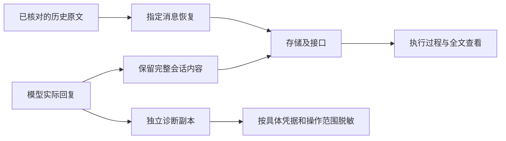

# 模型回复完整展示与指定历史回复恢复

## 背景、现状与目标

用户在 DevFlow 执行过程看到“模型回复：[敏感认证操作：仅保留状态]”，无法读取模型说明和下一步要求。本计划承接本会话已确认的四项方案：完整展示会话、分离诊断过滤、恢复指定历史回复、验证完整链路。

2026-10-19 16:42:11 的回复包含普通页面地址 /login，命中通用认证关键词规则；会话正文在存储前被整段替换。原始回复仍在主工作区运行目录。调查还发现回复在多层被截断至 16,000 或 65,536 字符，诊断流认证标记可能持续影响后续无关日志。

目标是让当前用户完整看到模型实际输出的回复，包括登录说明、代码、链接和长文本；刷新后仍完整可读；恢复指定历史消息，保护现有任务、服务、运行数据及其他未提交修改。只改前端占位文案或放宽一个关键词无法消除多层过滤，因此按完整会话链路修复。

## 总体方案与依据

会话内容与诊断副本各自处理：用户会话保留原文并按既有访问权限提供全文；诊断日志和明确对外导出的副本按用途脱敏。列表可以展示摘要，但必须有可读全文，不能将摘要当唯一原文保存。先完成并验证链路修复及恢复能力，再对指定历史消息实施精准恢复和实际页面核验。

关键定位仅用于调查，不限制实现文件：presentation/secret-redactor.ts 的 diagnosticText 按关键词替换整段；core/conversation-service.ts、runtime/run-telemetry.ts 和 presentation/activity.ts 多次应用同类规则；AGY conversation-source 还限制回复长度。shared publicEvent 的读取、缓存、推送与持久化调用都须分析，不能全局关闭过滤而泄露系统配置或诊断凭据。其他适配器及主会话、子会话使用同一展示链路时一并覆盖。

## 开发与恢复任务

- [x] W1 保留回复原文，使当前用户看到完整会话。区分模型已实际输出的会话正文与系统诊断，修正采集、分片合并、最终回复、存储、实时推送、接口、投影与页面链路。本人会话不再因 login、OAuth、认证提示、凭据样式或占位提示的引用而整段隐藏或自动替换原文。保留换行、代码块、链接和顺序；不把协议包或模型未提供的内容伪装成回复。
- [x] W2 支持长回复完整读取，避免只取消过滤却仍丢字。检查 16,000／65,536 字符限制及契约；摘要与完整内容有明确关系，可采用分页、分块或按需读取，避免无界内存和巨型推送。全文在流式结束、断线重连、刷新和服务重新读取后保持一致；完成事件覆盖分片时不能重复或丢尾部。前端可折叠，但能展开或进入全文，不以省略号结束且无恢复途径。内容以安全文本/Markdown 渲染，不执行回复内脚本。
- [x] W3 分离诊断过滤，保留有用错误并保护诊断凭据。认证判定依据具体操作及关联关系，不能仅凭普通说明或 URL 中出现 login 判定整段敏感。保留密码、令牌、私钥等在诊断副本中的遮盖；敏感结果限于对应调用，不能使整次运行后续模型回复和普通测试/构建错误永久隐藏。保留流式边界、跨流关联与异常输入保护，不通过简单删除安全测试达到通过。
- [x] W4 提供精准、可回滚、幂等的历史回复恢复。实施前核对下文身份、当前记录、原文文件及 result.json 摘要的一致性；明确替换同一活动或追加纠正记录的投影规则，使用户看到一条正确回复，保持原时间、归属、排序和历史可追溯性。仅保存必要的旧值与恢复标识，不复制整个运行数据库；事务失败全部回滚，同一恢复重复执行不产生重复消息，内容冲突或来源缺失时停止写入并说明原因。处理缓存和读取投影，不能只写数据库而页面继续显示占位。
- [x] W5 完成验证后恢复实际历史消息并核对页面。用户已授权恢复下文指定的一条历史回复，不批量恢复其他历史消息。先在隔离数据上验证恢复、重复执行、回滚和并发更新拒绝，再在主实例按核实的目标执行；核对页面正文与原文一致、刷新后不丢失、其他任务状态和事件不变。不重跑原模型，不修改原任务阶段、运行结果、模型绑定或调度状态。源文件仍为有效恢复依据，不能作为临时垃圾删除。
- [x] W6 完成测试、交付和本任务清理。使用正式工具链，完成下文验证并逐项说明结果。保留其他未提交修改，整合时只处理本任务改动；整合使检查失效时补跑受影响检查。记录恢复结果、必要回滚位置与删除条件，清理本任务不再使用的隔离测试库、临时构建、截图和脚本，核对释放空间；不清理其他任务产物。

## 指定历史回复及数据边界

仅恢复以下逻辑消息；这些标识用于准确定位，不是重新调度指令：

| 项目 | 已核实值 |
|---|---|
| 源工作区 | C:/Code/system-handle |
| 数据库 | C:/Code/system-handle/.devflow/devflow.sqlite |
| 原工作流 | wf-731fe4d1-a601-4c98-9af9-054b96e38a51 |
| 事件 | ConversationActivity，event_seq=16879 |
| 原时间 | 2026-10-19T08:42:11.442Z（北京时间 16:42:11） |
| 原运行 | run-8be110bd-4421-412b-af0c-3729695125ad |
| 会话 | cnv-d05fd823-cbe8-4101-82c5-c16b91cdecca |
| 活动 | d39a5c95-f76b-4556-8944-9c5916cf0f0b:reply |
| 原文 | C:/Code/system-handle/.devflow/native-runs/run-8be110bd-4421-412b-af0c-3729695125ad/raw-result.txt |
| 交叉核对 | 同目录 result.json 的 summary；调查时原文 2301 字节 |

若长回复需要新增全文存储或引用，应保留 workflow/run/conversation/activity 归属，沿用本人会话访问控制；只存确需的原文及引用，摘要不能替代原文。旧记录有原文则兼容读取，无原文不伪造。测试只使用合成数据，真实回复、凭据和数据库不得提交到 Git。

## 验证与完成标准

执行阶段分别完成 pnpm typecheck（包含测试）与 pnpm build，以及受影响测试。当前登记的 scripts/devflow/verify.mjs 的 build 排除测试且可能复用旧前端产物，unit 为目录级，integration 固定少数旧文件，不能代替本任务正式检查与影响分析。采用当前正式命令和具体测试目标，不扩大为修复整个平台检查配置。

- [x] A1 单元：普通 /login URL、OAuth/OTP 文本、原占位提示引用、凭据样式正文、Unicode、Markdown、代码块以及超过两处旧上限的回复保持完整；诊断副本仍正确遮盖具体凭据，后续无关错误可读，跨分片不漏凭据或吞正文。
- [x] A2 集成：真实隔离 SQLite、适配器、遥测、会话服务、读取 API、实时事件和历史回放贯通；全文与源文本一致，主/子会话归属正确、去重和排序保持，原有访问控制不变，普通工具输出和错误状态不退化。
- [x] A3 集成恢复：精准恢复目标消息、重复调用无重复、冲突拒绝、来源缺失拒绝、事务中断回滚；预置其他任务及其他消息并确认其数据不变；新旧投影与缓存一致。
- [x] A4 E2E：真实浏览器连接隔离前后端及存储，从任务执行过程进入模型回复，查看含登录链接及认证说明的内容，展开长回复末尾，刷新、重连、切换任务和主/子会话，检查正文完整及原有操作可用；执行历史恢复后检查只出现一条正确消息，不用全链路固定接口响应冒充验证。
- [x] A5 OpenTabs：额外操作真实浏览器核对执行过程、全文展开、代码块/长链接换行、桌面及窄屏布局、刷新回放，观察可见数据和画面；最终到原工作流核对 16:42:11 回复已恢复并可完整读取。隔离本地场景使用既有免密开发会话；不关闭授权规则，不要求无关业务 SSO 登录。当前可发现 OpenTabs 工具，执行时核实连接，不以 E2E 替代本项。
- [ ] A6 人工验收：用户在原任务找到指定时间回复并读到原文；新回复包含登录术语也完整可见，长回复全文可读，现有任务与未提交修改保持。人工功能确认保留。

## 工作区、运行保护与失败处理

本任务选择独立 worktree，位置遵循主仓库 .worktrees/ 约定；不在主工作区切分支、reset、stash、清理或提交其他改动。当前未提交修改涉及 README、执行界面、run-telemetry、native-activity、conversation-telemetry 及其他测试，实施前核对差异，仅整合本任务内容。计划原件保持单一正式引用，不新建替代计划。

隔离测试端口、数据与构建输出，复用现有依赖，不复制整个仓库环境或运行数据库。临时产物集中到本任务工作区的任务专用临时目录，开始前记录用途，结束核对引用后删除。已有服务、任务、配置、凭据、worktree 和运行数据库保持。实际服务切换若不能在不影响活跃任务的情况下完成，应保留已验证候选并明确报告受阻步骤，不能擅自停止任务或将隔离预览成功宣称实际修复完成；先继续所有不受阻工作。没有明确推送、公共发布授权，不推送或发布。

恢复结果须以实际页面验证为准；检查失败、全文无法读取或历史恢复未完成时，不能宣布任务完成。必要回滚仅撤销本任务的数据纠正或代码变更，不还原整个数据库覆盖并发业务数据。
