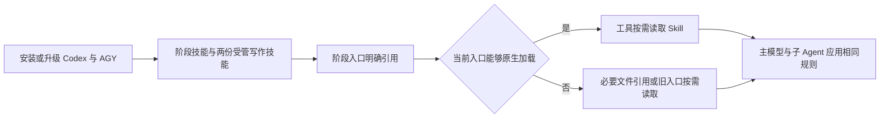

# Codex 与 AGY 统一写作技能和原生加载方案

## 背景与现状

用户已为本机 Codex 配置“简练完整表达”和“易读方案与计划”，希望 DevFlow 内参与工作的模型遵守相同规则，并优先使用工具原生 Skill 加载，避免每次交接重复传正文。

本次按用户最新确认，仅处理 Codex 和 AGY。其他工具尚未完整实测，不接入、不修改、不验证；源码中存在适配器不代表本次支持范围。

目前两个个人技能只在本机 `.codex/skills` 中确认存在。DevFlow 安装清单只有六个阶段技能，未包含这两个技能。执行交接会传入多份 Skill 正文；复核交接还同时通过 `skill_resources` 和 `skill` 重复传入同一份复核 Skill。只补安装文件，不能证明所有阶段和子 Agent 已经应用约束；直接删除所有正文，也可能破坏旧入口。

## 目标与制定原因

安装或升级 Codex、AGY 的 DevFlow 配置后，两项写作规则应随工作流可用。所有用户可见文字遵守简练完整表达；实际编写或修改方案、计划、整改安排时，同时遵守背景在先、先总后分的方案规则。不会要求执行、审查或提交阶段另写计划。

采用“统一安装、阶段明确引用、工具原生加载”的方式，减少重复正文和规则漂移。对尚不具备原生加载条件的旧入口保留必要兼容，不能为了缩短输入丢失约束。

## 总体思路

先按本机实际版本核对两种工具的安装、发现和读取链路，再加入两份受管技能。阶段入口只交代本轮任务及应加载的技能；工具能够原生加载时，不再随交接包附带技能全文。恢复和委派沿用同一要求，普通用户续聊保持原文。



### 当前依据与核实边界

| 工具或链路 | 已确认事实 | 本次处理 |
|---|---|---|
| Codex | 本机入口为 npm 的 `codex.ps1`，已读取版本为 0.162.1。安装器写入 `$CODEX_HOME/skills` 和用户 `.agents/skills`；本机两处都有 DevFlow 技能。旁路提问会使用独立 CODEX_HOME。 | 核对实际发现、同名去重、只读和旁路入口；不能仅凭文件存在宣称已加载。 |
| AGY | 本机程序入口为 `C:/Users/yckj4798/AppData/Local/agy/bin/agy.exe`；现有安装器在 Windows 使用 `.gemini/antigravity/skills`，本机该目录已有 DevFlow 技能。 | 本机二进制含项目 `.agents/skills` 模板，但未取得能证明全局搜索规则的运行结果，精确版本也未确认。保留现有目录，在执行阶段验证实际发现与读取；不依据文档差异迁移程序、凭据、MCP 或会话。 |
| 运行时材料 | Profile 执行传入多个正文；Profile 与旧 Runtime 的复核均重复包含复核 Skill。native-v2 的内置提示不等于已经原生加载技能。 | 同时处理材料生成端、桥接读取端和实际启动入口，避免只删一个字段。 |
| 旧 MCP 执行 | 旧入口限制模型使用原生文件工具，通过上下文接口按需读取执行 Skill。 | 保留该入口必要读取能力；不把已确认可原生加载的新入口也继续塞入全文。 |

关键代码依据为 `packages/clients/src/installer.ts`、`packages/core/src/execution-skill-materials.ts`、`packages/runtime/src/profile-runtime.ts`、`packages/runtime/src/runtime.ts`、`packages/runtime/src/review-materials.ts`、`packages/mcp/src/tools.ts`、`packages/adapters/agy/src/handoff.ts` 和 `packages/bridge/src/review.ts`。路径用于定位，不是修改白名单。

目前核实了源码、目录及部分工具帮助，没有通过真实模型调用证明两个工具的全部阶段均已加载并遵守规则。实施时必须区分安装成功、可发现、可读取和输出符合要求；不能互相替代。

## 执行安排

### 任务 T1 核实本机加载链路

这项工作确定技能究竟由哪个工具、从哪个位置读取，避免按文档推测修改有效配置。

- [ ] 核对 Codex、AGY 实际可执行入口、版本、配置根、Skill 搜索路径及当前启动参数；区分程序安装目录、配置目录和技能目录。
- [ ] 覆盖默认目录、已支持的环境覆盖、只读用途、旁路提问和恢复会话。优先使用工具自身的发现能力、帮助或本地实现；资料与本机不一致时，以本机证据为准。
- [ ] 将确认的原生加载条件用于后续实现；没有证据的能力保留为未确认，不自动当作不支持，也不宣称加载成功。保留 AGY 当前实际安装目录，不因本任务调整账号或配置域。

### 任务 T2 将两个技能纳入统一安装

这项工作让 Codex、AGY 使用同一套随 DevFlow 维护的规则，同时保护用户的个人技能。

- [ ] 以本机 `C:/Users/yckj4798/.codex/skills/concise-complete-writing/SKILL.md` 和 `C:/Users/yckj4798/.codex/skills/human-readable-plans/SKILL.md` 为规则来源，保留正文含义，增加受管名称 `devflow-concise-complete-writing` 和 `devflow-human-readable-plans`。
- [ ] 将两份技能纳入发行资源、Codex/AGY 安装及升级路径和缺文件检查；运行时不依赖这台电脑的用户名或个人源文件路径。
- [ ] 安装到 T1 核实的工具发现目录，遵循现有备份和升级约定；个人原名技能及其额外文件保持原样。Codex 双目录不能导致同一受管技能重复应用。
- [ ] 本次仅为 Codex、AGY 启用新的安装与加载行为，不扩展其他客户端的支持、权限或测试范围。

### 任务 T3 让工作流各阶段应用统一规则

这项工作确保约束覆盖所有角色，而不是只覆盖执行模型。

- [ ] 在接入、规划、开发、测试和复核的阶段技能中明确引用两份受管技能，并覆盖整改、规划接管、提交、验收指导及只读临时提问。
- [ ] 简练完整表达适用于回复、进度、交互问题、报告和文档。方案技能只在实际编写或改写方案时应用，保留原计划及批准范围，不产生替代计划。
- [ ] 主 Agent 委派任务时传递必要技能名称或可读取引用，要求子 Agent 同样应用；恢复、换工具或重建会话时补齐必要引用，不假定子 Agent 自动继承全部上下文。
- [ ] 保持用户原文续聊机制，不给每次用户消息拼接规则或重发整份交接包；新规则通过正常阶段入口和工具技能加载生效，不中断正在运行的任务强行注入。

### 任务 T4 原生加载优先并清除重复正文

这项工作减少交接内容，同时保留任务和权限合同。

- [ ] 对已核实可原生加载的 Codex、AGY 入口，交接只提供应使用的技能名称及必要定位信息，移除重复 `skill`、`skill_resources` 全文；统一处理 Profile、native-v2、复核与桥接入口。
- [ ] 仅在入口确实不能原生加载时使用兼容方式：能读取文件则传引用；旧 MCP 限制入口保留按需读取正文。保留旧会话材料的读取兼容，不把历史字段存在当作继续重复传正文的理由。
- [ ] 技能缺失、禁用或读取失败时明确报出具体问题，不静默跳过。安装或配置未就绪时先修复有效加载链路，不放宽终端、文件写入或其他无关权限。
- [ ] 保留用户需求、批准计划、整改意见、角色职责、只读边界、输出结构、测试结果目标和人工交互合同。只消除技能正文重复，不把审查变成执行、不把验收指导变成整轮开发，不新增平台审计关卡。

### 任务 T5 验证交付并清理任务产物

这项工作确认安装和加载链路有效，且不会破坏现有续聊与角色边界。

- [ ] 使用仓库锁定工具链，分别完成全项目类型检查、生产构建和受影响测试；结果须适用于最终代码。
- [ ] 验证下表场景；自动替身只能证明接线，不能代替真实工具的发现或加载结果。本机真实验证限 Codex、AGY，复用已有账号，不新增其他工具认证或验证。
- [ ] 更新相关安装和使用说明，说明技能适用条件、个人技能保护和必要兼容行为。人工核对一份方案及一条简短回复，确认表达完整、易读，方案先背景后细节。
- [ ] 清理本任务可再生临时安装目录、测试数据和中间输出；保留正式计划及简短验证结果。不得清理其他任务产物、共享依赖或正在使用的会话数据。

T2 可在 T1 调查过程中整理技能正文；实际安装目标以 T1 为准。T3 依赖 T2 的正式名称，T4 依赖 T1 和 T3，T5 在相关实现完成后验证。

## 验证与完成标准

| 层级 | 场景与预期 |
|---|---|
| 单元 A1 | Codex、AGY 的目标目录、加载方式选择、必需引用和适用阶段正确；方案规则不要求普通执行重新规划。 |
| 集成 A2 | 隔离用户目录中完成安装、重复安装、升级及缺文件失败；两项受管技能存在且个人原名技能和额外文件不变。 |
| 集成 A3 | 初始规划、执行、测试、复核、整改、接管、提交、验收指导和旁路提问得到正确引用；确认原生路径没有重复全文，旧入口仍可按需读取。 |
| 集成 A4 | 用户续聊原文不变；恢复和重建会话保留技能引用，角色限制、输出结构和人工交互不丢失；子 Agent 委派要求完整。 |
| 端到端 A5 | 从隔离安装产物到真实调度、子进程入口和完成结果跑通 Codex/AGY 相关链路；用本机工具核对发现与读取。替身链路、真实工具发现和真实模型输出分别报告，未验证项不宣称通过。 |
| OpenTabs | 本次没有前端页面、交互或样式变更，不适用浏览器仿人工核验；若实施确实产生前端影响，再补相应场景。 |

正式检查使用：

```powershell
pnpm typecheck
pnpm build
```

受影响测试按文件、类或用例定向执行。项目登记的旧 `scripts/devflow/verify.mjs` 存在固定测试集合和排除测试的构建入口，不能代替本轮正式类型检查与影响分析。执行阶段选择实际相关目标，不在规划阶段锁死测试文件或新增执行证明系统。

完成时应能确认：两工具安装获得两项受管技能；各角色有明确应用入口；已经证明可原生加载的入口不重复传正文；旧兼容入口不丢失约束；个人技能及其他任务保持；检查结果与限制如实报告。自然语言是否完全遵守仍须结合实际输出判断，传入引用本身不是遵从证明。

## 工作区与失败处理

本任务已按 DevFlow 新 worktree 模式登记，实施工作区由平台在项目 `.worktrees/` 下管理，保护主工作区现有未提交改动。规划正文保存在本任务 `docs/plan/` 目录；临时验证产物集中放在实施工作区的本任务临时目录，完成后核对路径和引用再清理。

加载失败时保留现有有效入口和用户配置，仅修复本任务必要问题；无法安全处理的同名冲突或权限限制须报告具体对象与影响。回退使用安装流程保留的受管文件备份，不回滚个人技能、账号或其他任务数据。不因本次修改停止现有服务、改变全局模型绑定、推送或发布。