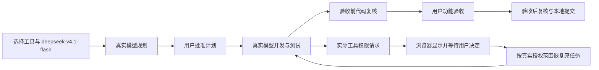

# 开放 Claude Code 与 OpenCode 并验证真实任务全流程

## 背景、现状与目标

DevFlow 已接入多种工具，用户此前隐藏了暂不使用的工具，现在需要重新开放 Claude Code 与 OpenCode，并确认两者能实际承担规划、执行和代码复核。测试必须通过真实浏览器、真实服务、真实 CLI 和真实模型完成，所有节点禁止 mock，尤其不能伪造或跳过用户授权。

当前共享工具目录只列 Codex 和 AGY；Claude Code、OpenCode 适配器仍存在。调查确认两项关联缺口：自定义模型缺少强度能力元数据时无法选择明确强度；原生权限请求转入等待用户、授权与恢复的现有实现仅支持 AGY。因此仅恢复下拉选项不能达到目标。

最终测试模型按用户最新指示为 **deepseek-v4.1-flash**，替代先前 Kimi K3。支持 medium 时使用 medium；无法选择 medium 时隐藏相关强度选项，按原生默认行为运行，不能伪造支持或偷偷传入 medium。两工具分别覆盖规划、执行、复核，共六种组合。调查读取的两份本机配置未发现 deepseek-v4.1-flash 的明确模型条目；其真实提供方、可访问性和能力须在执行阶段探测，不能猜测 provider 或沿用 K3/Flash 默认模型。

## 总体方案与依据

恢复这两个工具在所有共享选择入口中的可见性，沿用现有适配器、角色配置、模型目录、任务运行和人机交互机制；补通真实运行暴露的关联问题。先完成开发，再在隔离环境创建两个有实际代码产出的测试任务，分别用 Claude Code、OpenCode 承担三个角色，走完计划、用户批准、开发自测、两轮规定的质量复核、人工验收和本地提交。六种组合须分别确认实际运行，不能用配置保存或模型探测代替。

关键定位仅用于调查，不限制执行模型修改位置：
- `packages/contracts/src/model-catalog.ts` 的 TOOL_DISPLAY_ORDER 同时影响前端工具选择及服务端目录，当前仅含 Codex、AGY。
- `apps/web/src/components/ModelProfileEditor.tsx`、两适配器的 model-configuration 与 SDK model-selection 共同决定模型、强度选项及实际传参；unknown 不能视为 supported。
- `packages/runtime/src/profile-runtime.ts`、native-permission-recovery 与 API native-permissions 当前存在仅支持 AGY 的边界，需要接入两个工具实际支持的授权协议。
- 规划与复核为只读，执行具有任务范围内写权限；保持现有角色限制，不能靠全局自动同意或 bypass 跑通授权。
- OpenTabs 已连接真实浏览器并读到工作台；尚未运行本任务模型调用、授权或开发验证。

## 开发任务

- [x] W1 恢复两个工具的可用入口。让全局模型设置、任务创建、任务角色覆盖及后续配置入口一致显示 Claude Code 和 OpenCode；维持 Codex、AGY 和其他隐藏工具现状。检测不到 CLI 或实际不可用时显示可操作的原因；既有任务、模型选择与默认配置不被重置。
- [x] W2 正确选择真实模型并按能力展示强度。从实际 CLI、配置及提供方目录确认 deepseek-v4.1-flash 的准确标识和调用路径，OpenCode 保留完整 provider/model。支持 medium 才显示并传递 medium；不支持或未能确认可选择时隐藏强度选择，不写入或传递残留值。切换模型、工具、角色、保存后重开均一致。遇到旧配置的 medium，向用户说明将使用原生默认；已运行任务仍保留原冻结配置。不得将 CLI 接受参数当作提供方实际支持的证明。
- [x] W3 打通两工具的三角色执行。覆盖角色配置保存、后续派发、原生进程启动、技能与必要 MCP 可用性、输出解析、计划提交、执行结果、代码复核、暂停续接和本地提交。保持工具、模型、强度、原生会话与当前任务归属；错误应如实展示，不换工具或模型掩盖失败。规划/复核不得越权修改业务代码。
- [x] W4 补通真实权限交互。按两工具实际原生权限机制，将需要用户决定的请求展示到当前任务；用户决定前不执行该操作，批准后只放行对应操作并续接，拒绝或取消不得执行。沿用既有人机交互及暂停恢复机制，处理重复点击、过期请求、取消及任务归属。禁止改库造状态、伪造原生事件、用模型文字冒充权限请求或放宽全局权限。模型访问验证、原生工具权限、计划批准和人工验收分别处理。
- [ ] W5 运行两个完整真实测试任务。隔离测试项目中实现一个有明确输入输出的简单文本统计小工具，模型真实规划、编写源码与测试、运行测试、复核及提交。任务 A 三角色均显式选 Claude Code；任务 B 三角色均显式选 OpenCode；模型均为 deepseek-v4.1-flash，强度按 W2。真实浏览器完成创建、配置、审批、观察和验收流程，六种组合逐项记录结果。各工具至少真实触发一次需用户授权的受限操作，并验证拒绝不执行及批准后恢复；所需权限不得破坏规划/复核只读边界。（当前进度：已建立独立隔离环境端口 49152/49153 与独立测试仓库 text-stats/text-stats-b，两工具真实通过模型访问验证；任务 A 和 B 均已创建并由真实 CLI 启动规划。任务 A 触发 AskUserQuestion 授权请求 int-01f70f5b-f3ff-4326-8b25-19b616340de1；任务 B 触发 read 授权请求 int-1ee7ccba-52b1-4380-88fb-2246432c2196 并已在真实浏览器中呈现授权卡片。当前已推进至用户真实授权决定卡点，等待用户在浏览器中做出授权决定后继续后续流程。）
- [ ] W6 完成相关回归、交付与清理。执行阶段分别完成正式类型检查、生产构建及受影响测试；修复本范围内阻断开发和验证的问题，按 DevFlow 角色完成质量复核、人工功能验收和本地提交。保存最小结果记录，清理本任务无后续用途的临时产物，保护其他改动与活跃工作树。不推送或发布。

## 验证与完成标准

所有本次测试使用真实实现：纯函数可以直接调用，但不替换依赖；集成使用隔离真实存储、后端和 CLI；禁止 mock、stub、录制回放、固定接口响应、伪造模型成功或授权记录。既有含替身的测试不能作为本次全链路通过依据。

- [x] A1 单元：直接测试工具目录、模型/强度能力与参数构造等纯逻辑。只新增这两个可见工具；不支持或 unknown 时不展示强度选择、不残留 medium；支持时准确传递。没有必要通过伪造 CLI 输出覆盖分支，无法真实触达的分支明确写出限制。
- [ ] A2 集成：真实隔离数据库、API、目录发现和 CLI，验证配置持久化、六种角色绑定、模型访问、任务归属、结果解析及暂停续接。模型访问探测必须实际调用，不能以缓存结果代替首次真实验证；保持用户既有登录和凭据，禁止删除全局授权缓存或改写全局账号配置。
- [ ] A3 E2E：真实浏览器连接隔离前后端，分别跑完任务 A、B。每个工具实际产生规划结果、代码和测试结果、验收前后复核结果及本地提交；真实触发计划批准、原生授权及人工验收。需人工决定时发出具体交互并等待本人，模型不能代批。授权拒绝/取消不执行，批准后恢复正确会话且不扩大权限。
- [ ] A4 强度界面：通过真实模型目录验证 deepseek-v4.1-flash 的能力与页面一致；无法选择 medium 时相关选项不出现，切换工具或从支持强度的真实模型切回后无残留，保存、刷新、重开与实际启动参数一致。支持路径可选现有确实支持 medium 的模型只检查界面和配置；任务运行仍使用指定 deepseek-v4.1-flash。没有真实可用支持样本时报告缺项，不造目录数据。
- [ ] A5 OpenTabs：单独用已连接真实浏览器操作上述入口，检查模型名、角色、强度显隐、授权卡片、拒绝/批准结果、执行过程、刷新后的状态与错误提示。该项与 E2E 分别报告，不互相替代。
- [ ] A6 人工验收：用户可选择这两个工具，并查看六种组合的真实结果；确认授权内容、等待与续接符合实际操作，不能将模型自行声明完成视为人工确认。

执行阶段使用仓库锁定工具链，分别完成 `pnpm typecheck`（含测试）、`pnpm build` 和受影响目标测试。已登记的 verify.mjs build 排除测试且可能复用前端旧产物，unit 是目录级，integration 固定旧文件，不能替代正式检查及影响分析。无需扩大为重构全平台测试登记。

最小结果记录按工具、角色列明实际模型、medium 或原生默认、会话/运行归属、执行结果和授权结果；明确通过、失败、等待用户和未验证。记录供用户判断，不新增平台测试审计关卡。

## 环境、数据与失败处理

开发使用主仓库 `.worktrees/` 下的独立工作树；端口、数据库、测试项目与临时配置隔离，不停止或重启主实例及其他任务。复用现有依赖，不复制登录目录或凭据。主工作区当前有界面、遥测、文档及其他测试改动，整合时只处理本任务内容，发生重叠先核对现状。

沿用现有 Profile、冻结运行配置及权限交互记录，原则上不新增业务表。确需保存工具原生请求 ID、操作范围或授权消费状态时，沿用既有归属及生命周期，兼容 AGY 和旧记录；不保存令牌、密钥或原始认证响应。隔离配置只指向已有用户凭据，不提交到 Git。

如果指定模型未配置或提供方拒绝访问，先确认现有目录及错误；必要时明确请求用户补足真实访问，不能切回 K3、使用 Flash 默认或通过 mock 继续。若 medium 无法选择，按用户授权隐藏选项并用原生默认继续；其他实际不可实现的授权能力必须报告，不绕过。失败保留已完成工作，只回滚本任务变更。

正式计划仅此一份，保存在 `docs/plan/wf-70f3196a-48dd-4343-aaa2-595b94feda25/`；最小结果在对应 `docs/test/evidence/`。临时测试库、项目、截图、一次性脚本与构建输出集中在本工作树专属临时目录，用完即清；已登记任务仍引用的材料和必要回滚材料保留并注明删除条件。工作树仅在合入、任务结束、无活跃引用且未提交内容处理完成后，通过 Git/所属工具移除。结束核对清理和任务状态，报告实际释放空间。
