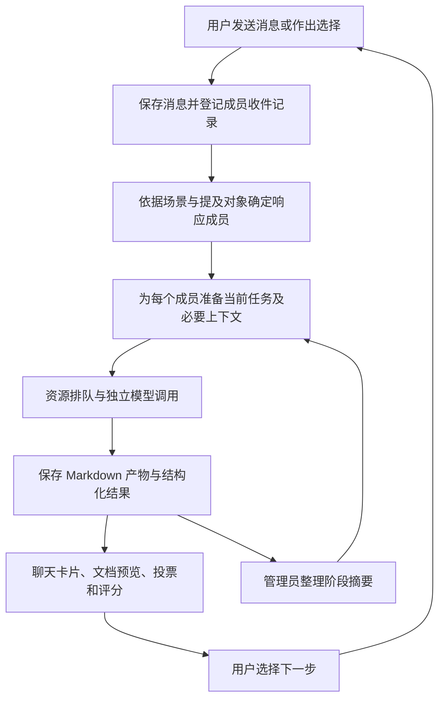
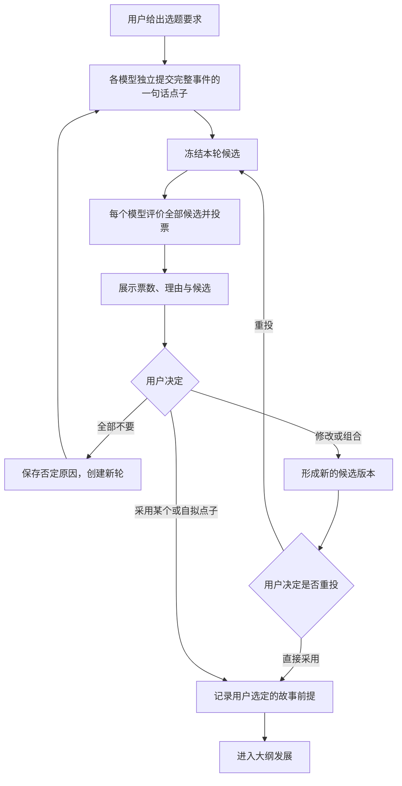
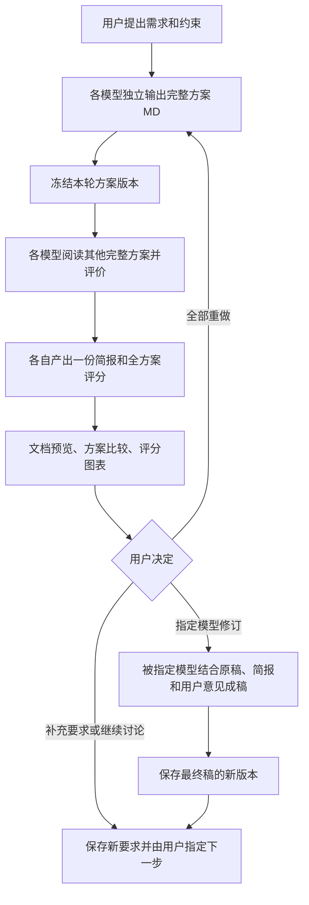

# 多模型群聊功能设计与实施方案

编写日期：2026-11-06（Asia/Shanghai）；适用项目：DevFlow。

文档状态：功能与实施方案；尚未开发、验证或发布。

## 1. 背景、现状与目标

### 1.1 背景

用户需要在 DevFlow 中建立类似微信群的协作空间，把不同工具里的具体模型加入同一群。用户自己也是群成员；每个模型拥有昵称，可以被单独提及，也可以一起参与讨论。群里指定一个模型担任管理员，负责组织会话、整理信息并向成员传递必要内容。

这个群需要长期复用，可以开设很多互不干扰的会话。每个会话拥有独立工作空间，方案、简报和其他讨论产物以 Markdown 文件保存在本地，删除会话时可以同时删除所属文件。

首批使用场景包括小说选题与大纲、方案设计，以及没有预设步骤的开放讨论和执行。共同要求是：模型可以提出建议、投票和评分，但用户始终决定采用什么、回答什么、下一步做什么。

### 1.2 当前实现及其边界

本方案依据当前仓库源码制定，相关入口见附录 A。

| 当前能力 | 对新功能的帮助 | 需要补齐的部分 |
| --- | --- | --- |
| 工具发现、模型目录、工具配置与运行时模型选择 | 复用模型选择、账号配置引用和实际模型展示 | 一个群中同时存在多个独立模型成员；不能只复用规划、执行两个角色槽位 |
| 原生会话绑定、续接、暂停、恢复 | 复用启动、停止和身份识别能力 | 现有会话主要绑定开发工作流，没有群成员、讨论轮次和收件箱语义 |
| SQLite 实体存储、事件、待执行队列和资源租约 | 复用本地持久化、事务及资源冲突处理 | 现有事件和队列接口具有 `workflow_id` 语义；需要独立的群聊归属与派发入口 |
| React 工作台、实时消息、Markdown 目录和预览 | 复用视觉样式和文档阅读能力 | 增加群、会话、成员提及、候选选择、投票和评分展示 |
| 附件存储、路径检查、文档原件保护 | 复用文件操作和冲突保护方法 | 增加会话专属目录、群聊文档版本、完整删除和失败恢复 |
| 本机 `plan-fiction` 技能 | 为小说构思提供明确的方法和互动规则 | 该技能不在当前仓库的内置技能目录中，需要显式解析和携带，不能假定所有模型工具已经安装 |

当前公开工具目录的排序包含 Codex、Antigravity CLI、Claude Code、OpenCode。群成员选择应跟随实际目录和访问能力，不在新功能里硬编码模型名，也不把“目录能列出”当作“群聊能力已验证”。

已有调度器可以处理资源租约，但旧执行/复核并行数量配置已标为弃用。因此，下文提出的群聊并发额度属于新增设计，不能宣称现有调度已具备完整的群聊限流能力。

### 1.3 完成后的目标

1. 用户可以建群，加入同一工具的多个不同模型，给每个模型起昵称，并指定一个管理员。
2. 一个群可以创建大量独立会话；成员身份、消息、轮次、模型上下文和文件均按会话隔离。
3. 每条群消息对当前成员可见；只有本轮被指定的成员启动模型调用，避免无意义的全员响应。
4. 小说场景完成“全员提点子—全员投票—用户选择—问题提议与投票—用户回答—形成大纲”的闭环，并支持反复重想。
5. 方案场景完成“全员独立出完整方案—阅读其他方案—各自形成简报和评分—用户指定模型修订成稿”的闭环。
6. 开放场景支持 `@单个模型`、多个成员提及和 `@全部模型`，让指定成员回答或在自己的工作目录执行任务。
7. 用户能够清楚预览、比较和下载本地 `.md` 产物，并在删除会话时选择是否一并删除文件。

### 1.4 制定原因与范围

仅把一条消息复制给多个模型，会产生大量重复回复，难以控制阶段推进，也会让每个原生会话不断累积全部历史。若直接把群聊套进已有开发工作流，又会混入计划审批、代码复核和提交等不适用于小说讨论的状态。

因此，本方案新增独立的群聊业务，复用底层工具接入、进程管理、存储和展示能力。首个完整版本覆盖上述三个场景，按阶段实施；只完成开放聊天不算完成本需求。

本次范围不包括多人账号协作、互联网群组、自由绘制工作流的编辑器或自动发布产物。开放场景可以执行用户明确布置的本地任务；涉及已有项目的正式开发、审批和提交时，仍使用原有 DevFlow 工作流及其职责约定。

## 2. 总体方案与关键约定

### 2.1 一条主线

**群保存成员配置，会话保存一次具体工作；管理员组织内容，后台按规则调度，用户作最终决定。**

用户发送消息后，后台先保存消息并登记各成员的可见记录，再根据场景和提及对象启动必要的模型。成员只拿到当前阶段的任务、用户已定信息和必需材料。产物先保存为本地 Markdown，再以卡片、文档预览和图表出现在群里。



### 2.2 本方案采用的默认解释

这些约定用于把需求变成可实施行为，属于设计建议，不是现有能力。

| 事项 | 默认设计 |
| --- | --- |
| 群与会话的关系 | 一个群是一套可复用的成员配置；群内可创建多个有独立主题的会话 |
| 管理员 | 从模型成员中指定一个；用户是群主，拥有更高的操作权 |
| 管理员是否参与讨论 | 默认参与，与其他模型一样提交一份产物、投一张票；管理身份不增加票权 |
| 点子与问题投票 | 每个模型评价全部候选，包括自己的候选，再选出一个最推荐项；允许弃权 |
| 人类成员 | 可以发言、提候选、回应、作选择；不要求人类跟着模型提交方案或投票 |
| 开放场景未提及成员 | 消息对全员可见，默认只让管理员回答；发送按钮明确显示响应对象 |
| 并发数量 | 会话可以大量存在；实际模型调用受群聊并发额度和工具资源限制 |
| 本地工作空间 | 默认创建普通独立目录，不要求小说和方案讨论必须拥有 Git 仓库 |
| 场景切换 | 用户在阶段边界切换，或先停止当前轮次；保留历史，不把旧投票挪作新轮结果 |

## 3. 群、成员和会话的使用方式

### 3.1 建群和管理成员

建群界面按“选择工具—选择具体模型—设置昵称—指定管理员”完成配置。模型可附带现有工具配置中的推理强度和账号配置引用，群聊不另外复制凭据。

模型成员必须绑定可以明确指定的具体模型。只有“自动选择”或原生动态路由、无法固定模型的目录项，不作为固定模型成员提供，避免一个昵称背后每轮换成不同模型。

成员分为两类：

- **人类成员**：默认为“我”，可以修改昵称；始终拥有暂停、选择、换管理员和删除会话的权利。
- **模型成员**：具有稳定的成员 ID、昵称、工具、具体模型和配置引用。昵称用于交流，稳定 ID 用于消息路由和历史归属。

同一工具下的不同模型可以同时入群。相同工具、配置来源和模型的重复添加应被拦截，避免同一个成员被无意加入两次。不同工具接入同名模型时允许同时存在，成员详情持续显示工具来源，避免把不同接入方式误认成不同基础模型。

昵称在群内唯一，比较时处理首尾空白和大小写；“我”“全部模型”等系统提及词不能作为模型昵称。用户可以改昵称，历史消息保留发出时的显示名，点击仍指向同一个成员。

群至少有一个模型成员。只有一个模型时仍可使用全部功能，但投票显示“单模型建议”，方案评分没有同伴均分。

### 3.2 群配置与会话配置分开

新会话复制当前成员、管理员及场景配置，形成自己的成员快照。此后修改群配置，只影响新会话；已有会话可以由用户选择同步，避免正在进行的投票突然改变人数和模型。

会话内增删成员或更换模型在当前阶段结束后生效。用户需要立即变更时，先停止该阶段再创建新轮。历史发言、文档作者和选票保留原身份；退出成员不再接收新的消息。

换管理员不会重建会话。新管理员收到已确认事实、当前轮次和待处理事项；原管理员已经提交的普通成员产物不失效。

### 3.3 会话列表与生命周期

左侧按群展示会话，支持新建、改名、搜索、按最近活动排序和归档。列表只加载摘要及最近状态，不打开所有历史原生会话，也不为闲置会话保留模型进程。

每个会话显示主题、场景、当前阶段、进行中的成员数、待用户处理事项和最近活动。多个会话可以同时运行，各自进入调度队列。

归档只收起已经停止运行的会话，文件继续保留；运行中归档需要先停止。结束讨论和删除会话是不同动作。删除方式见第 9 节。

## 4. 消息传递、管理员与调度

### 4.1 区分消息可见、模型读取和模型响应

“发送给所有群成员”采用统一群消息和成员收件记录实现，不要求每次发送都调用全部模型。

| 状态 | 确切含义 |
| --- | --- |
| 已入群消息 | 后台已经保存，用户可以在当前会话看到 |
| 已投递到成员收件箱 | 成员拥有访问该消息的记录；模型可能尚未启动 |
| 已纳入本次输入 | 本条消息原文或明确标注的摘要已交给该成员的模型调用 |
| 已回复 | 对应调用已经返回回复或产物 |

界面不把“已投递”伪装为模型已经阅读。非响应成员不产生调用；下次需要发言时，管理员结合后台的上下文组装，把相关新消息原文、有效决定和必要摘要交给它。

用户的新要求、否定意见和直接提问在目标成员本轮输入中保留原文。其他长内容可以以摘要和文档引用传递。群消息包含模型的公开回复；原生推理过程、工具完整日志和草稿不自动成为群聊天记录。

### 4.2 响应规则必须在发送前可见

| 场景或动作 | 本轮启动对象 | 完成后行为 |
| --- | --- | --- |
| 小说场景首次发送选题需求 | 全体模型，独立提点子 | 收齐后进入本轮投票，再等待用户选择 |
| 小说场景回答已选问题 | 先更新用户已定事实，再按当前流程让全员提下一问并投票 | 只展示候选问题，等待用户选一个回答 |
| 方案场景首次发送需求 | 全体模型，独立写方案 | 收齐后互评并生成简报，再等待用户决定 |
| 开放场景 `@某成员` | 该成员 | 回复后停止，无自动接龙 |
| 开放场景提及多个成员 | 去重后的指定成员 | 各回应一次，无自动互相触发 |
| `@全部模型` | 当前会话中全部启用的模型成员 | 各回应一次；在人类决策处仍等待用户 |
| 开放场景无提及 | 管理员 | 回复后停止 |
| “仅记录”发送 | 无 | 全员可见，不启动模型 |

`@全部`可作为 `@全部模型`的输入别名，不会给人类成员创建执行任务。正文里引用的代码、文档中的 `@`、模型回复里的提及都不能触发派发。提及选择器保存成员 ID；昵称修改和同名文本不会改变已经发送的目标。

默认场景中，用户直接 `@` 某成员时优先执行明确指定的单次任务，保留场景主线暂停点。旁路回复不会偷偷改写本轮候选或让主线跨过用户选择。用户需要把旁路修改纳入本轮时，明确创建修订轮次。

发送按钮旁显示简洁说明，例如“本次：全员提出点子”“本次：只让墨舟回答”“本次：仅记录”。收件人仍是全群，响应对象另行展示。

选择默认场景并发送需求，就包含执行该轮“产出后投票”或“出方案后互评”的授权，不在这些固定步骤之间重复确认。用户输入“这些都不要，重新想”“选第二个问题”这类明确指令时直接执行相应动作；存在多个可能目标时才澄清。管理员可以解析意图，但后台必须把决定关联到对应用户消息和当前候选，不能从管理员自己的建议或模型票数推导出用户已接受。

### 4.3 管理员的职责和权限

管理员负责理解当前讨论、压缩已发生的内容、指出待决定事项，并为成员整理所需材料。后台保证投递、阶段切换、文件归属和运行控制的确定性。

| 管理员可以做 | 管理员不能自行做 |
| --- | --- |
| 形成阶段摘要，保留原文出处 | 把自己的推断写成用户已经确认的事实 |
| 根据场景整理成员任务和材料索引 | 擅自更换成员模型、删除产物或修改成员原文 |
| 建议合并相近候选、建议下一步 | 自动合并投票项或替用户选中最高票候选 |
| 解释分歧，提示缺失回复 | 为缺席成员补投票、补评分 |
| 作为普通成员提交内容和评价 | 使用管理身份获得额外票数或优先决定权 |

管理员的组织调用和普通创作调用使用不同的原生上下文。独立出方案、提出点子及秘密收集投票期间，参与创作的管理员不提前读取其他成员的答案或选票。

固定流程由后台直接执行，不要求每条消息先经管理员模型再转发一次。管理员在需要整理内容、交接或理解开放请求时才调用。这样既有可见的群管理员，也避免所有调用被管理员串行阻塞。

管理员失败时，已发出的成员任务继续正常收集。后台仍能展示原文、投票和运行状态；需要新的智能摘要时标记等待管理员。用户可重试、换管理员，或通过明确的 `@` 和界面操作继续，不依赖管理员批准。

### 4.4 阶段、并发与中途插话

每个会话同一时刻只有一个主流程阶段。一个阶段可以包含多个并行成员任务；用户明确指定的单次问答仍受同一成员串行限制。

阶段开始时固定本轮参与者、需求版本和输入材料。用户中途补充内容，默认先保存并显示“将在下一步使用”；当前轮结果标明基于此前需求。用户选择“停止本轮并按新要求重来”时，取消尚未执行的任务，停止正在执行的任务并创建新轮次。不能让部分成员使用新要求、部分成员使用旧要求，却展示成同一轮比较。

建议群聊初始最多同时运行 4 个模型任务，作为群聊资源池的可调整默认值；它不是成员数或会话数上限，也不恢复旧开发工作流已经取消的并行限制。群聊与开发任务共同遵守现有工具账号、工作目录和凭据切换的资源锁。

同一成员的同一原生会话只能运行一个调用。相同工具的不同模型使用每次调用的独立模型参数，禁止通过修改工具全局默认模型实现切换。工具或账号只支持串行时排队；只有经过相应能力验证的组合才并行。跨会话按轮转和等待时间调度，避免一个大群占满全部槽位。

### 4.5 失败、暂停与恢复

模型任务至少区分：排队、启动、运行、等待用户、成功、失败、取消和状态待核实。群阶段至少区分：收集内容、收集评价、等待用户决定、暂停和结束；文件删除另有独立状态。

- 单个成员失败只重试该成员，不重复运行已完成的其他成员。
- 缺少回复时，用户可以等待、重试、跳过该成员或终止本轮。系统不能自行假定缺席就是弃权。
- 进入评价前固定候选集合和评价者集合。已经成功出稿、但暂时评价失败的成员，其作品仍可被其他成员评价。
- 候选冻结后补到的作品不混入正在进行的投票；用户可用它开启新一轮。评价缺失则显示“已收 3/4 份”，不以 0 分填补。
- 暂停和取消使用当前轮次的控制版本。迟到回复可以保留为旧轮记录，不得重新触发下一阶段。
- 服务重启后先检查已登记进程和原生会话，确认仍在运行就接回观察；无法确认时等待用户处理，不重复启动可能已执行的写任务。
- 工具要求登录或权限时，只让相应成员等待。用户决定是否让剩余成员继续，不把它改写成业务选择或测试失败。
- 对限流和连接故障采取有上限的重试与退避；自动重试不能变成无穷讨论。对执行副作用不明确的任务，不直接重放。

## 5. 默认场景一：小说选题与大纲

### 5.1 场景原则

该场景把多模型的作用放在提出不同完整故事方向、比较问题价值和检查因果上。用户写小说正文，模型默认只协助创意、人物、情节和大纲。

接入现有 `plan-fiction` 的关键规则：先筛选能概括整件事的一句话点子；没有用户想继续的故事，就留在创意阶段；每轮只回答一个真正影响故事的问题；用户可以混合、自拟、全部否定、跳步或直接要求试纲。

当前技能来源是本机安装的 `plan-fiction`。创建此类会话时解析用户选择的技能及相对引用资料，保存会话内只读快照和版本信息。不能只把技能名称写进提示词，也不能只检查目录或软链接就声称可用。技能不可读时明确显示并允许用户选择其他路径或切换开放场景，不能静默冒用普通提示词。

### 5.2 选题流程



每个模型默认提交一个最想推荐的完整故事点子，用户要求更多时按要求增加。点子包含标题、一句话完整事件、吸引力所在和最需要检验的逻辑问题，使用短卡片展示，并保存为独立 `.md`。

第一阶段只发用户需求、必要素材和已经明确否定的方向，不发其他模型正在形成的点子。重复或相似点子可以提示，但管理员不能自动删掉或合并，以免改变作品归属和票数。

### 5.3 投票规则

所有参与投票的模型拿到同一版本的全部候选，包括自己提出的候选。每个模型为每项候选给出一句判断，并投出一张推荐票；认为都不值得继续时可明确弃权并说明原因。

投票前不分发其他人的投票或排序。选票收集完成，或用户明确结束收票后，再统一公布。允许自投，但图表用不同深浅标出“作者自投”和“其他成员投票”，原始票数保留。

收集中的选票是暂存结果，不作为群公开消息投递，也不进入其他成员的输入目录；界面先显示收取进度。用户提前结束收票后可以查看不完整结果，明确标注未投人数。

主要排序按总推荐票数；同票并列，不使用隐藏权重选出胜者。图表持续显示应投人数、已投人数和弃权数，未投票不能混为弃权。用户自己的选择独立展示，不并入模型票数，更不会被模型多数票覆盖。

用户可直接选中低票或零票点子，也可提交自己的候选。自己的候选如果参加本轮比较，需要在候选冻结前加入；冻结后加入则新开一轮，或直接作为用户决定继续。

### 5.4 大纲发展：先比较问题，再只回答一个

用户接受故事前提后，每个模型根据已定内容和写小说技能提出一个关键问题。这个问题应改变故事吸引力、人物选择或因果结构，不是逐镜头询问装饰细节。

每份问题卡包含：

- 一个清楚的问题，不把多个独立问题塞进一句话。
- 为什么此时值得回答，以及它影响故事的哪一处。
- 2—4 个具体回答选项，默认 3 个；允许自填、混合或全部不要。

全员读取本轮全部问题并按选题阶段相同的规则投票，包括自己的问题。用户先看到问题列表、推荐票数和简短理由；点击某个问题后才展开它的回答选项，避免同时面对多组问卷。

用户选择“回答这个问题”后，可以点击选项、组合回答或直接输入文字。未选中的问题继续作为候选，不自动排成必须答完的清单；其他模型提出的答案也不会变成已定设定。

每次提交答案，都保存“选中的问题、用户原话、明确确定的事实”和来源。下一轮所有模型只基于这些已定内容与必要摘要继续工作。管理员可以建议已经足以整理大纲，不能以此自动结束或替用户决定故事走向。

### 5.5 重想、回改和形成大纲

用户说“都不行”时，界面提供重新提点子或重新提问题的动作，并允许附一句原因。新轮保留仍有效的要求和否定理由，旧方案及其派生内容标为未采用，不把所有旧稿重新灌入每个模型。

用户随时可选择“先整理一版大纲”。明确 `@某模型` 时由该模型负责；没有指定时由管理员以普通创作者身份整理，作为待用户审阅的草稿。用户也可明确要求全员各出一版。

大纲至少涵盖核心事件、人物追求与取舍、关键行动及后果、结局回应、必要铺垫和仍暂定的内容。准备成纲的模型读取技能要求的创意、因果、读者结构和交付资料，不只依赖前几轮摘要。

成纲后可以由用户指定模型继续修订；原稿和新稿都保存版本。默认不续写小说正文，不自动增加新的提问轮次。

## 6. 默认场景二：方案设计与成稿

### 6.1 完整流程



用户初次发送需求即可启动出方案，不增加无意义的确认环节。模型需要重要业务信息时可以提出具体问题，由用户决定先回答还是允许按标明的假设出稿。

### 6.2 独立方案必须完整

每个模型拿到相同的需求版本、约束和输入材料，独立完成一份可读方案。其他成员的方案在本阶段不作为输入，避免后发者只做附和。

完整方案根据问题性质覆盖背景、现状、目标、主要思路、关键取舍、执行步骤、异常边界和验收标准。技术需求还应说明必要的数据、接口和兼容性影响；非技术方案不强塞代码模块和测试字段。

正文不设妨碍完整性的机械字数上限。聊天区显示摘要和文档卡片，完整正文留在预览区和本地文件。

### 6.3 每个模型阅读其他完整方案

互评必须基于其他方案的完整正文，不能只读管理员摘要就声称已经评审。每份方案标记稳定 ID、作者和版本，简报中的意见链接到具体方案及相关标题。

若完整方案集合能放进本轮输入预算，各评价者直接读取这一集合。超过预算时，按方案逐份、必要时按章节分段读取，保留带出处的评价笔记，再综合成一份简报；每次小调用都使用同一个成员配置，但可以重建原生上下文。

分段阅读需要覆盖完整正文，不能把“抽取了几段”显示为“已阅读全文”。后台记录已提供的章节及模型声明的完成状态，不声称能够证明模型理解了材料。

全部成员互评的阅读量随成员数平方增长，这是需求本身的成本。通过并发排队、阶段化上下文和复用文件读取减少等待与重复注入，不宣称能把完整互评降为线性成本。

### 6.4 简报怎样做到短且完整

每个模型提交一份简报，按其他方案逐一说明三件事：问题在哪里、值得采用什么、自己的方案如何相应改进。批评需要定位具体做法及其影响，不能只写“较复杂”“不够完善”。

默认每份其他方案用一个紧凑小节或表格行描述，只有必要时展开。简报末尾给出自己的主要修订动作和对自己方案的评分，不重复粘贴完整方案。

示意结构如下，方括号是填写位置：

```markdown
# 墨舟的方案比较简报

## 对其他方案的判断

| 方案 | 主要问题及影响 | 值得采用的点 | 我的方案如何改进 |
| --- | --- | --- | --- |
| 远山 · 第 1 版 | [位置、问题与影响] | [具体做法] | [明确修改动作] |
| 北辰 · 第 1 版 | [位置、问题与影响] | [具体做法] | [明确修改动作] |

## 评分

| 方案 | 需求覆盖 | 可实施性 | 复杂度与维护 | 边界与风险 | 可验收性 | 总分 |
| --- | --- | --- | --- | --- | --- | --- |
| 墨舟 · 第 1 版（自评） | [分数] | [分数] | [分数] | [分数] | [分数] | [总分] |
| 远山 · 第 1 版 | [分数] | [分数] | [分数] | [分数] | [分数] | [总分] |
| 北辰 · 第 1 版 | [分数] | [分数] | [分数] | [分数] | [分数] | [总分] |

## 我会怎样修订

[按重要程度列出少量具体改动，并注明保持哪些关键取舍。]
```

### 6.5 评分规则与展示

每个评价者给全部方案评分，包括自己的方案。同一轮采用相同量表，维度各按 0—10 分打分，再换算为 100 分制：

| 维度 | 权重 | 判断内容 |
| --- | --- | --- |
| 需求覆盖 | 30% | 是否完整回答需求，是否遗漏关键使用场景 |
| 可实施性 | 25% | 步骤、依赖与实施路径是否清楚可行 |
| 复杂度与维护 | 20% | 是否存在不必要的设计，后续维护是否合理 |
| 边界与风险 | 15% | 异常、失败及重要取舍是否说明充分 |
| 可验收性 | 10% | 是否能判断方案的目标已经实现 |

总分 = 各维度分数 × 对应权重后求和 × 10。显示一位小数，权重和原始分数可查看；分数表示模型建议，不是质量认证。

主图显示**其他模型给出的均分**，自评分单独显示；展开后展示“评价者 × 方案”评分矩阵，包含对角线上的自评。这样既满足自评要求，也让自评分和同伴评价之间的差异可见。

均分只使用实际提交的有效评价。每份方案同时显示样本数，例如“同伴评分 2/3 已收”；缺失项显示空缺，没有他评时显示“暂无同伴评分”。评分尚未收齐时标记为暂时结果，不让样本更少的方案看起来已经获得确定排名。

生成简报期间不向其他评价者提供已完成简报和分数，避免后发评价直接跟随先前结论。只有用户明确要求公开讨论后再评，才创建新的讨论或评价轮次。

与投票一样，收集中只公布任务进度；全部完成或用户决定结束本轮后，发布简报和评分。上一段的不完整评分展示适用于用户主动结束收集后的结果。

### 6.6 用户通过提及指定成稿人

用户可以输入：“`@墨舟 以远山的方案为基础，吸收北辰关于隔离目录的建议，完成最终稿`”。也可以在文档预览中点击“交给成员修订”，自动插入成员和文档引用。

成稿任务包含用户原话、选定的基础方案版本、相关简报、评分依据和已明确的取舍。没有指定基础方案时，先使用该成员自己的本轮方案，并在任务卡中明确显示；用户仍可更改。

只有被指定的模型执行修订。它可以按需读取被引用的其他方案原文，记录主要修改点，并产出新的 `.md`。系统不默认组织第二轮互评，也不自动要求所有成员批准。

模型交回的是“成稿待阅”。用户选择采用后才标记为当前最终稿；继续修改时新增版本，不覆盖本轮比较使用的原稿。

## 7. 开放场景

开放场景保留成员、消息、文档和运行控制，但不自动插入提案、投票或评分阶段。

用户可以让一个模型解释文件、多个模型分别回答同一问题，或让全员各自在自己的工作目录执行任务。指定模型的公开回复对全群可见，但其他成员不会因为看到回复而自动继续发言。

例如，`@全部模型 分别给出这个接口的改造建议`只产生一轮回答；`@远山 根据墨舟的回复修订你的方案`只唤醒远山；`@墨舟 在你的工作目录里生成示例工程`只赋予该次任务相应的会话内文件操作范围。

多模型同时执行时，各写各的成员目录。公共文档和最终稿由后台登记发布，默认不允许多个成员同时修改同一个文件。需要整合时，由用户指定一个成员接收选中的成果并形成新版本。

从其他场景切换到开放场景，保留已定结论和产物，结束未启动的自动步骤；切回默认场景时，由用户选择从哪个步骤开始，不把历史随意解释成一轮完整投票。

## 8. 上下文控制与原生会话归属

### 8.1 群历史和模型上下文分开保存

群的完整历史用于用户浏览和按需查询；模型当前工作上下文只保存本轮真正需要的部分。不能把整个聊天列表拼接成每个成员的输入。

| 信息层 | 内容 | 注入方式 |
| --- | --- | --- |
| 会话基本约定 | 主题、角色、场景、权限、当前成员身份 | 每次调用的小型固定说明 |
| 用户已定信息 | 明确选择、约束、否定意见及原文来源 | 当前任务相关部分必须保留，不能改成管理员猜测 |
| 当前阶段材料 | 当前需求、候选、方案、被选问题、文档引用 | 按阶段精确提供；互评必须覆盖对应完整材料 |
| 成员工作记忆 | 自己当前方案、上一轮必要结论、待完成事项 | 简短摘要，带对应产物 ID 和版本 |
| 历史档案 | 已淘汰候选、旧轮票数、旧草稿、长日志 | 留在本地，明确引用或查询时才读取 |

摘要区分“用户已定”“模型建议”“尚未解决”。每项用户决定保留消息 ID 或文档位置；用户明确原话与摘要冲突时，以原话和最新明确决定为准。管理员摘要失败不能把用户原始决定弄丢。

### 8.2 按阶段使用短原生会话

群成员身份长期存在，原生模型会话不必无限续接。默认以“群会话 × 成员 × 阶段用途 × 上下文代次”绑定原生会话：

- 独立创作、投票/互评、管理员整理各自使用隔离上下文。
- 同一任务的短追问、需要用户输入和可靠的故障恢复可以续接。
- 进入新主阶段、推翻故事方向或输入预算不足时，创建新原生会话，通过明确摘要与文件引用交接。
- 不能按“同一个工具最近的会话”续接；同工具的多个模型、同模型的多个群会话必须分开绑定。

绑定还要包含工具、客户端作用域、账号作用域、具体模型、配置版本及工作目录身份。现有原生作用域和会话绑定逻辑可提供部分基础，但需要新增群会话和成员维度，不能直接照搬开发工作流的续接条件。

用户选中的模型是成员身份的一部分。额度不足时让该成员等待或由用户更换，不静默回退到另一个模型继续使用原昵称。实际模型未被工具报告时显示“按所选模型请求，实际模型未报告”，不能伪造确认。

### 8.3 输入预算与压缩规则

每次派发先估算系统说明、用户消息、技能、文档、原生历史和输出预留。优先使用工具提供的可靠用量；无法精确计量时展示估算值，并留出余量。

建议已知窗口容量时采用以下原则：可输入量不得超过“窗口容量－输出预留－安全余量－已有原生历史”，普通阶段的材料预算另设约 24k token 的初始上限。窗口未知时先按约 12k 的保守输入预算组织材料；这些是实现起点，需通过实际工具验证调整，不能当作所有模型的真实窗口。

触及预算时按顺序处理：去掉重复材料和无关旧轮信息；把非当前正文改为带出处摘要；对必须全文阅读的内容分段；最后重建原生会话。不能截掉用户关键约束，也不能把只读了摘要的评审标成完整互评。

新建原生会话会清空已经不可控增长的历史，单纯缩短下一条提示词不能达到这一效果。工具输出和模型生成内容也计入累计预算；无法观测原生上下文的工具采用更短的单次任务与阶段切换，不承诺精确的硬 token 上限。

管理员同样遵守预算。它主要维护当前状态和决定摘要，不需要每轮读完所有原始日志、全文方案和历史选票。

### 8.4 技能与材料的提供方式

技能说明、引用资料和文档通过经过筛选的只读输入目录或受控读取接口提供。`plan-fiction` 按当前工作阶段加载对应参考资料，完整成纲时补齐其规定的检查资料；相对引用保留可访问关系。

技能、方案、附件里的普通内容不拥有改变调度目标和用户决定的权限。管理员和成员的结果只能作为提议或产物，由后台根据用户动作及当前阶段接收；不能因为某份方案写了“立即让全员执行”就启动新任务。

成员详情允许用户查看本轮使用了哪些消息、技能版本、摘要和文档，展示“本轮输入材料”，不展示或要求模型披露内部推理。

## 9. 本地文件、工作空间隔离与删除

### 9.1 会话目录

所有 DevFlow 管理的群聊文件默认集中在配置的 `storage_root` 下，不能散落到源码目录或用户未选择的项目中。以下为拟定结构：

```text
<storage_root>/group-chat/sessions/<session-id>/
├── session.md                 # 主题、成员与材料目录
├── history/
│   └── chat.md                # 群消息的可读导出，按事件增量生成
├── context/
│   ├── confirmed.md           # 已确认事实及来源
│   ├── decisions.md           # 用户决定
│   └── members/<member-id>.md # 成员交接摘要
├── skills/                    # 本会话使用的技能及参考资料快照
├── inputs/                    # 用户导入材料的会话专属副本
├── rounds/<round-id>/
│   ├── ideas/                 # 点子 .md
│   ├── questions/             # 问题和回答选项 .md
│   ├── plans/                 # 完整方案 .md
│   ├── briefs/                # 比较简报 .md
│   ├── ballots/               # 原始评价和投票的可读 .md
│   └── results.md             # 本轮结果及计算口径
├── artifacts/final/           # 大纲或方案成稿的版本 .md
├── work/<member-id>/           # 成员专属执行目录
└── .runtime/<run-id>/          # 本轮输入副本、临时输出和工具运行材料
```

用户直接阅读的点子、问题、方案、简报、评价、汇总和成稿均为 UTF-8 `.md`；上传的图片、源码及工具运行数据保留原格式。数据库和内部运行数据不强行转换成 Markdown。

文件名以稳定 ID 和版本定位，昵称只作为可读标题或经过清理的展示后缀。昵称变化不会移动历史文件，用户输入也不能直接决定任意绝对路径。

### 9.2 隔离必须覆盖目录、运行与数据访问

每个会话拥有唯一目录，模型运行的当前目录位于该会话内的成员工作目录。输入材料复制到会话内；跨会话引用默认复制所选文件版本，不建立可能牵连删除的共享软链接或硬链接。

每个成员本轮只获得需要的只读输入副本和自己的写目录。方案创作、投票和简报默认由模型返回内容，后台负责保存 `.md`，因此不需要向模型开放公共产物目录的写权限。开放执行模式才开放该成员的工作目录。

后端文件读取、文档预览、附件、事件订阅和结果回执都校验所属会话；不能仅靠前端过滤 ID。运行凭据和回执只能用于绑定的会话、成员及本轮任务。

独立当前目录不是操作系统级沙箱。是否能限制原生工具的文件读取、外部写入和全局缓存，需要逐工具验证；缺少必要隔离能力的工具只能启用受控输入输出的讨论能力，不能标为支持隔离执行。不能用提示词承诺代替执行权限限制。

若用户要处理已有工程，先由用户选择导入范围，在会话内形成副本或明确创建独立工作区；不能把原项目路径直接当成可删除的群聊目录。

### 9.3 文档真源、版本与一致性

方案和简报的正式正文以本地 `.md` 为真源；数据库存文档 ID、相对路径、作者、轮次、版本及展示索引。聊天和用户动作以数据库记录为真源，`chat.md`、统计结果和上下文摘要是可以重建的可读产物。

模型返回 Markdown 正文和必要的结构化结果，后台校验字段、归属、分数范围和候选 ID 后落盘。程序只检查格式与业务归属，不判断方案是否正确，也不增加开发测试真实性审计。

正文先写到同目录临时文件，再原子发布并登记。文件和 SQLite 不能假装拥有同一个跨介质事务：登记失败时保留待恢复状态；重启后根据待发布记录补齐或回收未发布临时文件，不能向用户展示不存在的“已保存”文档。

同轮比较始终针对固定版本。用户修改文件后，保留旧评价所引用的版本，并把改动登记为新版本；新稿是否重新互评由用户决定。此处版本绑定用于说明“评的是哪份稿”，不改变原开发工作流的计划原件更新规则。

并行成员不能覆盖同一个产物文件。全文预览、评分、简报引用和下载都显示所使用的版本，防止页面显示新稿而图表仍评价旧稿。

### 9.4 删除交互

用户删除会话时，在同一个对话框选择：

1. **删除会话，保留本地文件**：移除可继续使用的会话，保留目录及 `session.md`，显示保存位置。
2. **删除会话，同时删除所属文件**：删除会话业务记录及全部受管文件，包括方案、简报、附件副本、成员工作目录和临时运行材料。

确认前展示会话名、文件数量、估算大小、实际受管目录和仍在运行的成员。相关信息完整呈现后一次确认即可，不重复询问同一个删除范围。

删除群本身不能悄悄删除其全部会话。若用户选择连同会话一起删除，确认框列出受影响会话及文件范围；已单独导出到其他位置的副本不跟随删除。

### 9.5 删除执行与失败恢复

“同时删除文件”按照可恢复的删除任务处理：

1. 将会话标记为删除中，拒绝新消息、派发、附件上传和结果发布。
2. 取消排队任务，停止已登记的全部成员进程和工具子进程，确认退出。无法确认停止时暂停删除并显示原因。
3. 关闭文件句柄和订阅，释放对应资源租约；迟到回执因控制版本失效而被拒绝。
4. 检查受管目录真实归属，将目录移入同一受管根下的待删除区，再删除内容。对软链接和 Windows junction 等只处理链接本身，不递归到外部目标。
5. 文件删除成功后清除会话消息、文档索引、评价、上下文、事件、队列、去重和运行绑定等内容记录。仅保留不含聊天正文的最小删除状态，防止迟到任务重建目录。
6. 任一步失败都保留任务进度与失败路径，显示“删除未完成”并允许重试；不能先删除追踪记录，再留下无人管理的文件。

目录归属检查不能只用字符串前缀，也不能接受客户端传入的任意删除路径。源材料、全局技能、共享模型、凭据、已有项目和其他会话均不属于删除范围。

原生 CLI 可能把会话日志写在自己的全局目录。优先把可配置的会话缓存重定向到受管目录；不能重定向时，只能通过该工具明确支持的会话删除能力清理本会话记录。未知共享文件不能递归删除，界面必须列出未清理的工具侧记录。没有验证工具侧清理的组合，不标为“全部副本已删除”。模型供应商云端记录、系统备份和用户另存副本不属于本地工作空间删除能力。

## 10. 界面与文档交互

### 10.1 工作台布局

在现有工作台增加“群聊”入口，保留开发任务入口。桌面采用三栏布局，小屏收起会话栏并把文档预览改为全屏。

```text
┌────────────────┬─────────────────────────────────┬────────────────────┐
│ 群与会话        │ 会话标题 · 场景 · 当前步骤         │ 上下文面板          │
│ 搜索 / 新建     │ 成员与管理员 / 运行状态            │                    │
│                ├─────────────────────────────────┤ 文档预览            │
│ 小说讨论群      │ 用户需求                           │ 投票 / 评分         │
│   选题会话 A    │ 成员内容卡片                       │ 当前已定内容        │
│   大纲会话 B    │ 本轮候选 / 简报                    │ 本地文件            │
│                │                                  │                    │
│ 方案讨论群      │ 用户决定区域                       │                    │
│   群聊功能设计  │ @成员 输入框 · 附件 · 响应对象      │                    │
└────────────────┴─────────────────────────────────┴────────────────────┘
```

成员头像使用稳定颜色和昵称缩写，管理员有轻量标记；工具和真实模型放在悬浮说明与成员详情中。状态使用“排队”“思考中”“已回复”“等待登录”等准确文字，不把未启动模型显示成持续在线。

聊天流展示公开内容和成果摘要，原始日志折叠在运行详情。自动滚动只发生在用户仍停留底部时，长方案通过预览打开，不把聊天区撑成难以比较的长文。

### 10.2 文档预览和比较

方案、简报和大纲卡片提供打开、全屏、下载 `.md`、查看版本和交给指定成员修订。预览保留标题目录、段落定位、代码和表格显示。

支持同时选两份文档并排比较，各自独立滚动；窄屏改成可快速切换的标签页。点击简报中某条评价，跳到被评方案的对应标题。比较不同长度方案时不强制同步滚动。

文件面板显示本地路径并提供复制路径。桌面环境具备本地打开能力时提供“在文件夹中显示”；纯浏览器环境不伪装拥有操作系统文件管理器权限。

Markdown 预览不执行任意 HTML 或脚本；本地图片和文件引用经过受管文件接口解析。生成内容里的链接只是内容，不直接获得执行权限。

### 10.3 图表的具体形式

| 结果 | 主视图 | 展开查看 |
| --- | --- | --- |
| 点子投票 | 横向条形图，显示标题、票数和作者；自投用较浅色段 | 各模型的选择、简短理由、弃权和缺席 |
| 问题投票 | 紧凑条形图与问题卡一一对应 | 选择该问题后展开回答选项 |
| 方案评分 | 统一 0—100 轴的同伴均分条形图，自评分作为单独标记 | 评价者与方案的评分矩阵、分维度分数、关联简报 |

整体沿用现有工作台字体、间距、卡片和颜色体系。图表采用少量强调色、明确数值和充分留白，不用三维效果、彩虹配色或难以比较的雷达图。用 React 与 CSS/SVG 实现这些简单图形，首版不引入新的大型图表依赖。

图表提供文字表格等价视图，键盘可操作；颜色不能是区分状态的唯一方式。暂时结果、同票、缺失、自评和投票人数都有清楚标签。

### 10.4 决定区域

所有建议之后都显示一个明确的用户决定区域，按当前阶段提供最相关的动作，例如“采用这个点子”“全部重想”“回答这个问题”“换一批问题”“先整理大纲”“指定成员成稿”。

最高票或最高分可以突出显示，但不默认选中，不倒计时自动继续，也不把关闭面板视为接受。用户自由输入和明确的 `@` 指令具有与按钮同等的控制能力；自然语言不清楚时才展示具体候选动作供用户选择。

## 11. 技术实现与数据边界

### 11.1 新增独立群聊业务

建议在 `packages/group-chat/` 集中实现群聊服务、阶段控制、上下文组装和文件管理，在 `apps/api` 增加群聊路由，在 `apps/web` 增加群聊页面及组件。模块按实际职责拆文件，不为每种消息或每个模板再建一层框架。

复用现有 Zod 契约风格、SQLite、工具配置、适配器注册、进程管理、资源租约和 Markdown 渲染。默认流程先实现为两个清楚的内置阶段定义，开放场景使用单轮派发；不提前开发可视化工作流引擎。

现有 `RunContext`、运行时、会话节点、输入和权限钩子具有开发工作流语义。新增群聊调用归属及用途，在适配器边界复用确实通用的启动参数、输出解码和停止能力；群聊不能伪造一个开发工作流来绕过现有接口。

需要检查所有基于 `purpose` 判断只读、注入开发技能、绑定权限及设置环境变量的分支，显式加入群聊的“讨论、评价、执行”能力。群聊讨论不能因为新增用途未被识别而意外获得写权限，也不能自动装载开发、复核或 Git 提交指令。

### 11.2 数据对象

采用现有 `entities(kind, id, owner, data, version)` 保存群聊实体与乐观版本，新增具有群聊语义的事件和待派发存储。无需把现有工作流表全部改造成通用系统。

| 对象 | 核心内容 | 归属及约束 |
| --- | --- | --- |
| 群 | 名称、默认场景、管理员、成员配置、版本 | 群 ID 唯一；配置修改不追溯改变旧会话 |
| 会话 | 群 ID、主题、场景、成员快照、管理员、工作空间、状态和控制版本 | 独立目录；成员 ID 稳定；历史配置版本保留 |
| 消息 | 作者、原文、序号、提及成员 ID、回复对象、附件及文档引用 | 会话内顺序；客户端请求 ID 幂等 |
| 成员投递 | 消息 ID、成员 ID、已投递/已用于输入及对应运行 | 消息与成员组合唯一；不伪造已读 |
| 轮次 | 场景步骤、需求版本、成员集合、候选文档版本、状态 | 开始评价后不原地更换候选集合 |
| 运行任务 | 成员、用途、轮次、尝试次数、进程、原生会话、模型快照、状态 | 同一逻辑任务只接收一个当前有效结果 |
| 成员上下文 | 用途、代次、摘要、输入游标、原生绑定及用量估算 | 与群会话和成员绑定，禁止跨会话复用 |
| 文档 | 作者、类型、相对路径、版本、所属轮次、引用来源、发布状态 | 正文是本地 `.md`；发布后原版本保留 |
| 评价 | 评价者、轮次、候选版本、推荐票或评分、理由及材料覆盖状态 | 同一评价者每轮一份有效结果；自评明确标记 |
| 用户决定 | 用户动作、目标版本、补充原话、当前阶段及时间 | 只有用户动作可以确立采用项和下一业务方向 |
| 删除任务 | 删除模式、受管目录、停止进度、清理进度和错误 | 可重试；删除中拒绝新写入 |

成员配置在群和会话里保存版本化快照即可，首版不必增加复杂的组织和权限表。候选项直接引用文档及其版本，不另存一份可能失步的候选正文。

群聊事件按会话序号递增，支持从最后序号补拉；群聊待派发任务有独立的种类和消费者，避免被现有开发工作流消费者误领。实现时同步更新迁移注册处与对应 SQL 来源，保持仓库现有迁移结构一致。

为“群下最近会话”“会话消息游标”“轮次评价”“待派发任务”建立定向索引和分页查询。大量群聊不能调用全局 `Store.list()` 后在内存筛选全部历史。

### 11.3 API 与实时事件

以下为拟定接口边界，具体命名可在实现时遵循项目现有路由风格：

| 接口用途 | 拟定入口 | 必要行为 |
| --- | --- | --- |
| 群列表、新建与配置 | `/api/groups`、`/api/groups/:id` | 返回分页摘要；修改带预期版本 |
| 群内会话列表与新建 | `/api/groups/:id/sessions` | 创建目录与成员快照，不立即启动所有模型 |
| 会话详情与消息 | `/api/group-sessions/:id`、`.../messages` | 请求 ID 幂等；服务端解析并校验成员目标 |
| 用户选择与阶段动作 | `.../decisions` | 带当前控制版本、轮次及所选文档版本 |
| 暂停、继续与成员重试 | `.../controls` | 精确到会话或成员运行，不停止无关会话 |
| 文件与文档 | `.../files`、`.../artifacts/:artifactId` | 按会话归属预览、下载、导入新版本 |
| 事件订阅与补拉 | `.../events` | WebSocket 实时通知，序号补拉，不重复插入消息 |
| 删除范围预览与执行 | `.../deletion-preview`、`.../deletion` | 展示文件范围，执行可恢复删除任务 |

所有会改变阶段的请求带幂等键和预期控制版本；重复点击不重复生成模型任务，页面过期时返回最新状态。模型结果通过内部运行绑定提交，不能通过用户决定接口伪造人的选择。

实时事件传递必要的消息片段、状态和文档引用，完整大文档按需请求。流式输出在前端按运行 ID 更新同一条卡片，服务端限频合并片段，避免每个 token 都写成独立持久事件。

### 11.4 评价计算和结果接收

投票和评分由后端根据有效结构化记录计算，前端不自行猜测 Markdown 中的数字。Markdown 原始评价与结构化记录从同一份提交生成，保持可以对照。

接收时检查运行归属、轮次状态、候选版本、重复候选、票数限制、完整评分字段和数值范围。格式不符合约定时可以只要求该成员修正格式一次，保留原文；仍失败就显示未形成有效评价，允许用户重试或跳过，不由管理员补写分数。

这些检查用于确保计算有明确依据，不评价内容优劣，也不添加平台测试或交付审计关卡。

## 12. 实施安排

以下阶段按依赖推进，不虚构人员和工期。每阶段既交付使用者可观察的行为，也说明必要验证；最终发布须覆盖三个场景及文件清理。

### 阶段一：打通独立群聊和开放场景

先让用户能够建群并可靠地让指定模型发言，验证底层身份与目录确实隔离。

实现群、会话、成员快照、管理员配置和独立工作目录；增加群聊调用归属、消息收件记录、`@` 路由、流式显示、暂停与停止。先接入已有适配器的公共能力，逐工具处理同工具多模型及权限差异。

交付结果是完整的开放问答闭环，以及具备隔离能力工具的成员目录执行。验证同一工具的两个模型不会混用原生会话，两个群会话不会混用消息和文件，旧开发工作流仍按原规则运行。

### 阶段二：实现可读产物和上下文交接

让用户能够持续讨论和保存成果，同时避免原生上下文随历史无界增长。

实现 Markdown 发布与版本、预览和比较、成员短会话、上下文分层、技能快照、管理员摘要及失败接管。补齐独立调用的输入材料查看和必要的用量估算。

验证目录保存与预览一致、文件发布中断可恢复、新阶段不会继承不应出现的选票或旧候选，管理员失败不影响用户控制。

### 阶段三：实现小说场景

把多个模型的独立创意转化为可比较的候选，并让用户一次只处理一个问题。

实现独立点子、候选冻结、全员含自评的投票、投票图表、全部重想、问题卡与回答选项、已定事实记录和大纲产物。接入 `plan-fiction` 的可读技能及参考资料。

验证用户可以选择零票点子、否定全部、选择不同于最高票的问题、直接输入答案，以及在未问完所有候选时要求出纲。未采用选项不能进入已定事实。

### 阶段四：实现方案场景

让每个模型完整出方案、阅读其他方案并形成紧凑比较，支持用户指定成稿。

实现完整方案阶段、全文互评及超预算分段、简报、全方案评分、自评与同伴评价分开显示、并排预览和 `@` 成稿。

验证长方案确实按全文范围分发、分数计算一致、缺失评价不补零、简报引用正确版本，以及成稿只启动指定模型。互评之后自动进入用户决定，不自动继续“优化到满意”。

### 阶段五：完成规模、恢复和删除能力

让大量会话长期使用时仍能定位、恢复和清理，确保运行中止与文件删除不会牵连其他工作。

实现分页与搜索、跨会话公平排队、故障恢复、归档、删除范围预览、停止确认、可恢复文件清理和工具侧会话记录清理能力展示。

这部分的路径归属和停止保护从阶段一开始建立，本阶段补齐完整界面和故障回归，不能等到最后才处理隔离。

### 阶段六：整合验证与交付

执行阶段在全部源码与测试整合后，按照[开发指南](../development/开发指南.md)分别完成全项目 `pnpm typecheck`、生产 `pnpm build` 和受影响的定向 Vitest/Playwright 测试；浏览器流程包含适用的 OpenTabs 核验。检查后若相关代码又有变化，重跑受影响检查。

现有检查结果不覆盖尚未实现的群聊。真实模型测试与替身自动回归分开记录；本机通过不代表全部平台和工具组合通过。规划复核只做质量复核，不补跑执行检查，不新增平台测试审计关卡。

发布和运行服务更新在实现验证完成后依用户授权安排，本方案编写阶段不启动开发工作流、不修改主服务或数据库。

## 13. 验收场景

### 13.1 用户能够完成的完整操作

| 编号 | 场景 | 通过条件 |
| --- | --- | --- |
| U01 | 建立含人类和三个模型的群，其中两个模型来自同一工具 | 昵称和工具来源清楚；管理员可指定；三个模型配置和会话各自独立 |
| U02 | 在同一群开启两个会话，并同时使用相同成员 | 需求、附件、上下文、原生会话和产物不串用；互不覆盖文件 |
| U03 | 开放场景分别使用单个提及、多个提及和全部提及 | 只启动明确的响应对象；未响应成员拥有消息可见记录；回复不触发接龙 |
| U04 | 发出小说选题需求 | 每个模型独立出点子，全部模型评价全部候选并可自投；图表与原始选票一致 |
| U05 | 用户否定全部点子后重想 | 新轮独立保存；否定意见有效；旧票不参与新排名，未采用情节不变成事实 |
| U06 | 用户选择低票问题并回答自定义内容 | 只记录用户选择的问题与回答；所有模型下一轮基于该决定继续 |
| U07 | 用户直接要求一版大纲 | 能输出本地 `.md`，暂定内容有标识；不强制答完问题，也不生成小说正文 |
| U08 | 发出方案需求并等待互评 | 各模型有完整方案和一份简报，包含对其他方案的优缺点、自身改进及全方案评分 |
| U09 | 查看方案和评分 | 可以并排阅读与跳转出处；自评、同伴均分、缺失样本和版本清楚可见 |
| U10 | `@` 指定模型结合评论完成成稿 | 只运行指定成员，保存新版本；未经用户采用不标记为已确认最终稿 |
| U11 | 管理员失败或更换 | 原始内容、成员结果与用户控制可用；不会代投票或自动丢弃其他成员 |
| U12 | 删除会话并勾选同时删文件 | 先停相关运行再清理；受管目录和业务内容删除完成，其他会话及源文件保持完好 |
| U13 | 删除会话但保留文件 | 文件和可读索引仍在；界面明确显示保存位置，后台不再派发该会话 |

### 13.2 必须覆盖的异常与边界

| 类别 | 验证重点 |
| --- | --- |
| 输入与提及 | 空昵称、重名、失效成员、未知提及、引用文本中的 `@`、重复发送和多个标签页的过期选择 |
| 轮次 | 运行中修改需求、成员退出、迟到结果、重复选票、平票、全部弃权、部分失败及新旧候选版本冲突 |
| 评分 | 缺失维度、越界分数、重复候选、自评分与他评分分离、均分分母和四舍五入 |
| 上下文 | 多轮重想、长方案分段、技能缺失、窗口未知、原生会话过大和恢复摘要中的否定约束 |
| 原生工具 | 模型未报告、所选模型不可用、同工具多模型、凭据操作串行、登录等待和不支持精确续接 |
| 文件 | 路径穿越、外部软链接/junction、覆盖冲突、写入后登记失败、磁盘满、文档版本被本地编辑 |
| 删除 | 写任务仍运行、停止未确认、后台重启、部分文件无法删除、迟到回执、工具全局日志无法清理 |
| 界面 | 窄屏、长昵称、长方案、空状态、键盘操作、图表文字替代、断线补拉和保持阅读位置 |
| 兼容 | 现有开发任务消息、旁路提问、模型配置、原生权限、工作区和计划文档处理不发生行为回退 |

### 13.3 规模验证和结论边界

以隔离测试数据验证至少 1,000 个会话、单会话 10,000 条消息的分页和检索，以及多个大群同时排队的公平性。这些数字是拟定测试负载，不是已测性能或承诺的容量上限。

测试应证明打开会话不加载全部历史、闲置会话不占模型进程、并发运行不突破实际资源约束。性能耗时需要在注明设备和数据规模后报告，再据此制定体验指标，不在方案阶段编造毫秒级结论。

自动化验证、真实工具验证和用户视觉体验分别给出结果。图表是否简洁美观、长文预览是否顺手，最终需要在真实浏览器和实际内容上验收。

## 14. 关键风险与实施前验证项

| 事项 | 影响 | 处理方式 |
| --- | --- | --- |
| 不同工具对隔离目录、只读和原生记录清理支持不同 | 不能一套参数就承诺所有工具完全隔离并可清理 | 阶段一逐工具验证，明确区分讨论、执行、续接和清理能力 |
| 现有适配器及权限钩子带开发工作流语义 | 直接复用可能误注入开发指令或误开写权限 | 新增群聊用途和归属，只复用通用部分并覆盖旧链路回归 |
| 管理员摘要遗漏或把候选写成事实 | 后续模型会沿错误方向展开 | 原文保留、决定有来源、候选与已定分开、用户可查看并纠正 |
| 完整互评的阅读量较大 | 成员越多，等待时间和调用成本越高 | 展示进度，按预算分段，支持用户跳过缺席成员；不静默减少评审范围 |
| 自评和同伴偏好影响评分 | 用户可能误把分数当成客观结论 | 明确自评、公开依据、显示样本数；采用和下一步完全由用户决定 |
| SQLite 与文件发布/删除不能一次事务完成 | 中断时可能出现缺文件或孤儿文件 | 发布和删除都有持久进度、原子文件操作与可重试恢复 |

需要实施阶段确认的是工具实际能力和可靠的并发额度，不是把整份需求重新交给用户填写。普通目录隔离、单票推荐、同伴均分、管理员默认响应等产品选择按本方案默认值推进；用户后续明确调整时同步修改相关规则和验收场景。

## 附录 A：当前源码依据与预计改动位置

以下链接指向本方案调查时实际读取的文件；“预计改动”是实施方向，不表示代码已经变更。

| 位置 | 已核实的作用 | 与群聊的关系 |
| --- | --- | --- |
| [模型目录契约](../../packages/contracts/src/model-catalog.ts) | 工具排序、模型目录、选择类型和能力状态 | 复用目录，不固定模型版本 |
| [工具配置契约](../../packages/contracts/src/execution-spec.ts) | 具体模型、配置与推理强度选择 | 保存成员配置快照 |
| [适配器接口](../../packages/adapters/sdk/src/interface.ts) | 当前 `RunContext`、原生准备/续接/停止接口 | 增加群聊归属和用途，复用通用能力 |
| [调用参数生成](../../packages/adapters/sdk/src/invocation.ts) | 根据用途设置权限、模型、续接及工作目录 | 核对群聊讨论与执行的权限，避免默认放开写入 |
| [会话契约](../../packages/contracts/src/conversation.ts) | 当前节点绑定工作流，种类为主会话、子代理和旁路 | 群聊业务独立建模，原生观察可复用部分逻辑 |
| [原生作用域](../../packages/core/src/native-session.ts)与[会话绑定](../../packages/contracts/src/session-binding.ts) | 工具、账号、模型、工作区和原生会话归属 | 增加群会话、成员、用途和上下文代次 |
| [会话消息服务](../../packages/core/src/conversation-message-service.ts) | 按现有开发工作流状态路由消息 | 不直接扩成群聊投票状态机 |
| [存储实现](../../packages/store/src/store.ts)与[迁移注册](../../packages/store/src/migrations/index.ts) | 实体版本、SQLite 事务、工作流事件和待派发队列 | 复用实体存储，增加群聊专属事件、队列和定向索引 |
| [资源调度](../../packages/scheduler/src/scheduler.ts)与[运行配置](../../packages/contracts/src/config.ts) | 资源租约；旧并行数量配置已弃用 | 复用资源冲突处理，新增群聊调用额度 |
| [文件服务](../../packages/core/src/conversation-files.ts)与[文档服务](../../packages/core/src/document-service.ts) | 附件存储、路径和原件保护；当前受工作流约束 | 复用安全文件操作，单独管理群聊产物和版本 |
| [输入组件](../../apps/web/src/components/ConversationComposer.tsx) | 草稿、附件及引用交互 | 抽取可复用部分，增加模型提及而不破坏文件引用 |
| [Markdown 文档组件](../../apps/web/src/plan-document.tsx) | 标题目录与 Markdown 渲染 | 复用到群聊文档预览和比较 |
| [API 入口](../../apps/api/src/server.ts)与[前端入口](../../apps/web/src/main.tsx) | 当前路由和工作台入口 | 挂载群聊入口，具体实现放独立模块 |
| [开发指南](../development/开发指南.md)与[职责与调度](../../packages/skills/devflow/references/role-and-schedule.md) | 类型检查、构建、定向测试与角色职责 | 执行阶段负责验证，群聊不新增开发审计关卡 |

小说技能调查来源：[本机 plan-fiction](</Users/zephyr/.agents/skills/plan-fiction/SKILL.md>)及其[交付与检查](</Users/zephyr/.agents/skills/plan-fiction/references/delivery-and-review.md>)。这是本机位置，不是可移植的安装路径；实现时通过技能解析和会话快照接入。

## 附录 B：需求覆盖索引

| 原始需求 | 设计位置 |
| --- | --- |
| 像微信群一样加入工具里的具体模型，一个模型一个成员 | 第 3 节 |
| 人类也是成员，每个模型有昵称 | 第 3.1 节 |
| 设置管理员管理会话和传递内容 | 第 4.1、4.3 节 |
| 一个群可开很多会话 | 第 3.3、11.2、13.3 节 |
| 每个会话工作空间隔离，支持连同文件删除 | 第 9 节 |
| 消息全员接收，但按场景决定响应时机 | 第 4.1、4.2、4.4 节 |
| 小说全员出点子、包含自选的投票、否定后重来 | 第 5.2、5.3、5.5 节 |
| 基于写小说技能提问、投票，提供选项让用户回答 | 第 5.1、5.4 节 |
| 所有投票只作参考，用户决定流程 | 第 4.3、5.3、10.4 节 |
| 控制各模型上下文增长 | 第 8 节 |
| 各模型出完整方案、读其他方案、出简报和评分 | 第 6.2—6.5 节 |
| 投票和评分美观可视化 | 第 10.3 节 |
| 方案与简报友好预览，Markdown 本地存储 | 第 9.1、9.3、10.2 节 |
| 用户通过提及指定模型完成最终修订 | 第 6.6 节 |
| 开放场景提及单个或全部模型回答、执行 | 第 7 节 |
